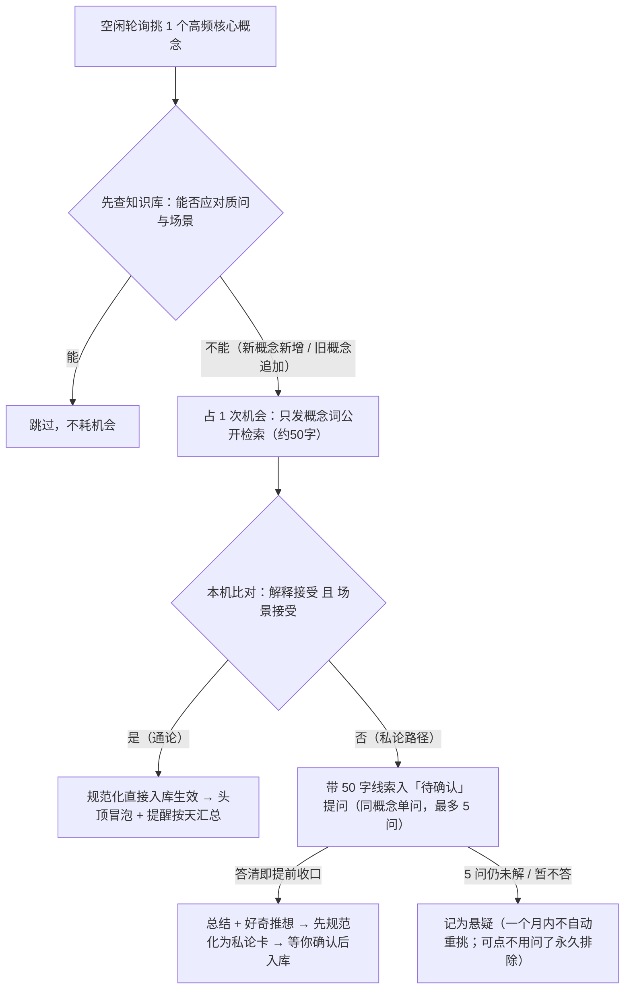

# 绯月交互本地优先需求

## 绯月主动质问与好奇（通论与私论，2026-11-25 JST）

2026-11-25 JST，用户已确认本需求口径与全部待决细节。现阶段仅整理需求，未进入详细设计与开发。下文原样保留用户原话及后续确认。

> 我要改进绯月的质疑和悬疑部分，绯月现在并不会有我想了解一个出现在我的记录里的内容 后自己去主动寻找结果，不够像人，我打算给她每天最多10次机会，她可以对某个更高频率，更核心，且她的知识库里没有的内容产生质问和好奇，质问是这个概念是什么，为什么会提出这个问题（场景）。好奇是这个概念能对”绯月“和”绯月的夫君“如何影响，有何帮助。她会先通过api去找一个50字左右的简短描述，如果这个描述可以解释质问和场景，那么这就是一个”通论“，如果不能作为通论被接受（解释不接受或者场景不接受），那么需要向我提出询问，她可以就一个问题向我提问最多5次。我的回答被总结后作为解释。这是”私论“。 通论不需要我确认，私论需要我确认，然后经过定向规范化后加入绯月的知识库。绯月质问前需要去查询知识库，确认当前解释是否存在，是否能应对质问和场景。不能时如果是新概念，则准备新增，如果是已有概念，则准备新增。新增时原则上只追加不改旧，除非解释错误，这种情况需要我确认。 请分析我的需求并进行补全整理和简化。现阶段只整理需求。
>
> 1.ok 2.网上查询的内容她只用报告告诉我新增了什么，不用等我确认。私论必须等我确认。
>
> 可以从新闻中找。她会在头上冒一句原来 X 是……，也许能帮夫君……，然后在提醒中给我说一声就行。同意先规范化。不需要冷却。同意。
>
> 新闻方向一天最多取2此，且进入流程和登录的内容，不可重复。被选择过的内容一个月内不能第二次进入处理流程。纠错入口给一个重新整理的机制，在确认界面和知识库对应页面上。我可以直接触发，要求此项立即进入重新处理流程，占名额，可以超越上限。其他的我觉得没问题。

### 1. 目标与边界

- **目标**：让绯月能主动从你的日常记录与新闻里发现「高频、核心、知识库未覆盖」的概念，先自行公开检索尝试弄懂（通论），解释不了再带线索向你追问并沉淀（私论），补齐现有「仅被动查库（K1/K2）」与「仅直接问事实（手记质问/日记悬念）」的缺口。
- **规则优先级**：本需求中「通论免确认直接入库生效」与既有知识库 K5「用户确认后草稿生效」冲突，**以本需求为准**；「被选择过的内容一个月内不二次进入自动处理流程」取代首轮「不需要冷却」。
- **不包含**：
  - 知识库服务器同步与服务器修正页（仍属知识库二期）；
  - 每日机会结转、按天手动调整机会上限的设置项；
  - 从任意外部网页（非规定记录及新闻）主动抓取候选概念；
  - 未经用户确认自动改写已有旧解释；
  - 好奇推想的二次联网检索或外部求证。

### 2. 核心概念与状态

| 概念 / 状态 | 定义 | 是否需用户确认 |
| --- | --- | --- |
| **质问** | ① 这个概念是什么；② 为什么在记录/新闻里提到它（场景） | — |
| **好奇** | 该概念对「绯月」或「绯月的夫君」有何影响与帮助；标为「她的推想」，不强行硬凑两方，纯背景知识可如实说明「帮我更听懂夫君平时在聊什么」 | 随通论免确认；随私论一并确认 |
| **通论** | 公开检索约 50 字简述，**同时**满足「解释接受」且「场景接受」 | **否**（直接生效，气泡+提醒报告） |
| **私论** | 通论不成立时，向你追问后总结并**先规范化**形成的解释卡 | **是**（确认后生效） |
| **悬疑** | 问满 5 次仍无法形成可确认解释，或你暂不回答的未解收口状态 | —（一个月内不再自动重挑） |
| **重新整理** | 你在确认界面或知识库对应页面手动触发的纠错重跑机制 | 沿用结果对应确认规则（改旧必确认） |

### 3. 选材、配额与去重规则

| 维度 | 规则 |
| --- | --- |
| **每日总配额** | 每天（东京自然日）最多 **10 次**，不结转；`1 次机会 = 1 个概念进入公开检索`。查库已能解释的跳过不计；断网导致的检索失败退还机会、稍后重试 |
| **新闻配额** | 新闻方向每天最多取 **2 次**（计入每日 10 次总配额） |
| **候选来源与优先级** | 个人记录（对话线中用户的发言、日记、用户对念叨/质问的回答；排除不留记录的语音专聊）**优先于**新闻 |
| **去重与排除** | 已进入处理流程或已入库的内容不可重复进入；**被自动选择过的内容一个月内不能第二次进入自动处理流程**；用户点「不用问了」永久排除 |
| **与 K2 协同** | 命中正向激励库 K2 已有待补充卡的同一概念时，不重复发起，直接并入该卡 |
| **挑词与运行节奏** | 不做每日批量预排；在现有轮询空闲时隙（无前台对话/在途任务时）按需逐个处理：先按频次粗筛并过滤不可选词，再由本机模型挑出当前最值得问的 **1 个**核心概念（主语/主题，而非顺带一提） |

### 4. 主流程与分支规则

1. **先查库三态**：质问前必查本机知识库：① 已能应对质问与场景（跳过）；② 已有概念但当前场景未覆盖（准备追加）；③ 新概念（准备新增）。新概念与追加场景走同一条链路。
2. **公开检索本机边界**：复用现有公开检索能力，**请求只发概念词本身，不外发用户记录原文**；场景比对在本机完成。检索无结果按不接受处理。
3. **通论分支**：一次生成「约 50 字简述 + 一句好奇感言」，规范化后直接作为正向卡入库生效。头顶气泡冒出这句好奇感言（如「原来 X 是……，也许能帮夫君……」），「提醒」按当天合并为一条今日新增清单，每项可直接跳转对应知识卡。
4. **私论分支**：复用现有「待确认」质问队列（上限 20）。发问时带上已查到的 50 字线索与当前场景的矛盾点；**同一概念同时只挂 1 问**，每收到一次回答即判断是否已够解释，够了立刻提前收口，最多 5 问。队列满 20 时暂停消耗当天剩余自动机会。收口后合并回答与好奇推想，**先规范化再请你确认**，确认后入库生效。

### 5. 入库结构、只追加与「重新整理」

| 规则项 | 要求 |
| --- | --- |
| **入库载体与字段** | 直接复用现有正向知识卡（不新建库或页面），定向规范化记录：标题与别名、约 50 字定义、场景（来源记录/新闻类别）、与绯月/夫君的关系（好奇推想）、来源标记（通论附公开来源 / 私论附用户回答摘要） |
| **只追加不改旧** | 新概念新建卡；已有概念默认只追加新场景与解释，不覆盖旧内容 |
| **纠错触发与确认** | 仅当新查到的内容或你的新回答与旧卡**直接矛盾**，或**你主动指出有误**时，才生成修改稿；修改旧内容**必须经你确认**（通论纠错同样适用） |
| **「重新整理」入口** | 在**确认界面**和**知识库对应页面**提供「重新整理」按钮：你手动触发后，该项**立即进入重新处理流程**，不受一个月自动去重限制，**占用当日名额且允许超越每日 10 次上限** |

### 6. 验收标准

| 编号 | 对应章节 | 用户应能观察到的行为 |
| --- | --- | --- |
| C1 | §3 | 个人记录（优先）或新闻中高频出现的核心概念且库里未覆盖时，绯月在空闲轮询逐个挑出处理；库里已能解释的概念不打扰也不消耗机会。 |
| C2 | §3 | 每天（东京自然日）自动处理最多 10 个概念，其中新闻方向最多 2 个，不结转；断网导致的检索失败不占次数；跨日重置。 |
| C3 | §3 | 已进入处理流程或已入库的内容不会重复进入；被自动选择过的内容一个月内不会第二次进入自动处理流程；点「不用问了」永久排除。 |
| C4 | §4 | 公开简述能同时解释含义与场景时，直接以「通论」规范化入库生效，无需确认；头顶冒一句好奇感言，「提醒」按当天合并清单报告新增内容，并可跳转对应知识卡。 |
| C5 | §4 | 公开简述不能解释含义或场景时，带着查到的线索在「待确认」向用户发问，同一概念一次只挂一问、答清即提前收口、最多 5 问；队列满 20 时暂停消耗剩余自动机会。 |
| C6 | §2、§4 | 用户答完后，绯月总结回答并附不强行凑两方的好奇推想，先规范化为「私论」卡再请用户确认；确认后才入库生效，拒绝或修改按用户意见处理。 |
| C7 | §5 | 已有概念默认只追加新场景不改旧；出现直接矛盾或用户指出错误时提供修改稿，必须经用户确认才改动旧内容。 |
| C8 | §5 | 在确认界面和知识库对应页面触发「重新整理」后，该项立即进入重新处理流程，占用当日名额且允许超过每日 10 次上限。 |
| C9 | §4 | 公开检索请求只包含概念词本身，不外发用户记录原文。 |

## DeepSeek 手记悬念上限

> 加个限制，只取最多4件最重要的未处理事项。

每次 DeepSeek 成稿最多留 4 件有原材料依据的未处理或待确认事项，去重后按重要性降序，正文没有未决事项时留空。保存和后续筛选须允许第四件。

## 本机短任务与执行时限调整（2026-11-23 JST）

> 结合现有deepseek兜底，本地应该只处理简短描述和简单判断的情况下，如何精简本地执行，现在看起来似乎过于复杂了。
>
> 另外解开本地执行时间的限制
>
> 开始改造
>
> 另外这个模式下是否多线程调度机制已经没有意义

首轮改行动补评、手记成稿和本机推理时限。补评原文、来源和已知状态由业务程序保留，短评优先由 CPU 2B 一次生成。短手记保留原材料正文，仅生成一句感受。获准外发的复杂手记跳过逐条补评和本机候选，直接使用原 DeepSeek 客户端，等待回包时释放本机模型时隙。私有及明确限本机材料沿用已有边界。普通本机推理取消 45 秒补评、120 秒单项、30/60 分钟整轮与 60 秒前台等强制执行时限。取消、退出、模型启动失败处置和云端网络超时仍按各自生命周期处理。多条复杂本机业务仍按已有专用路径处理，模型内部计算线程独立于任务调度。

当前短手记分流取单条且正文不超过 240 字，属于本次工作区实现取值。下面旧的本机候选和执行预算要求保留作历史依据，首轮范围以本节为准。

**时限更新（2026-11-25 JST，以本段为准）**：上段「取消强制执行时限」中的单项时限已调整。提交 `016bfd1` 的发布单记载需求「全局单次 AI / 网络超时增加 5 分钟（`300_000 ms`）上限」；用户在 2026-11-25 核对文档与代码的差异后决定「保留并更正文档」。现行范围见[设计](docs/DESIGN.md#本机短任务与无推理时限2026-11-23-jst)：排队任务按任务累计推理最多 5 分钟，单次网络与 AGY CLI 调用最多 5 分钟；45 秒补评、120 秒单项、30/60 分钟整轮与 60 秒前台时限仍保持取消。

## 展示内容先审核与 DeepSeek 兜底（2026-11-23 JST）

> 本地聊天也加入deepseek保底机制，输出给我的内容如果需要被审核，审核不通过直接就带着最多5轮历史丢给deepseek进行拟人回复。
>
> 总之是每个除去简单的内容外，以后要给我看的内容都需要审核，审核不通过就带上合适的上下文内容交给deepseek兜底。

普通问候和简短确认直接答复。需要交付实质文字的普通对话、问答、公开检索整理和手记先审核，合格才展示。普通对话明确退回时，使用当前发言和同线最近最多五轮，直接由 DeepSeek 一次生成并自审最终答复。其他获准外发的内容各带任务所需材料和相应提示词。手记整批能放入本地 8K 时用两份独立候选及审核，候选总字数最多 400。生成或二选一装不下、两份候选均超字数或审核都退回时，整批交 DeepSeek，保留手记结构和绯月第一人称。本机直连、带本机资料的专用路径和实际业务执行按既有权限处理。

### DeepSeek 本机任务日志

用户追加：「deepseek调用必须在本地留下明确的记录，我需要查看 输入，输出，响应总时长，放在任务日志里。」

桌面端通过共用客户端发出的 DeepSeek 调用，在「任务 → 任务日志」按用途和东京时间显示。回执显示响应总时长，展开可看请求输入、最终响应或失败回执。输入输出在本机加密保存，密钥不进入日志。调用中断时保留已登记的请求及未收到回执的状态。

## 大批量手记直连 DeepSeek

以下为旧的四片触发方案，以上述 8K 整批与审核兜底要求为准。

> 专门处理大批量文字，（切片大于3）时触发。这时候不再切片，而是直接通过接口三轮需求合一扔给deepseek并要求它完成前要自审并且保持最终输出的数据形式。发给deepseek的内容仍旧要求简洁化整理对话内容，但是不再干涉上下文和总体长度。
>
> 算了，先别走服务器，直接本地把
>
> 直接本地访问deepseek
>
> 也行，你先自己模仿接口调整内容。

采用桌面端专用接口，Flash 低档思考。只在本地预估至少四片时提交完整一批，三片以内走已有 4B；整批仍简述对话，并在交付前自查事实和格式。沿用段落正文、短评及待答问题。DeepSeek 路线不设置应用侧上下文、生成 token 或总字数上限。此轮用模拟接口验证。

## 手记整理的双 4B 与到点启动（2026-11-23 JST）

> 把上下文固定为*8+8的双4b为主，GPU紧张时单8k的4b逻辑，同时双4b是按照三段式处理，单4b时忽略第二轮。带上输入超长时的自动拆分和自动合并功能。规则参考上面的实验结果。*
>
> 另外取消必须等一定数量才能启动ai处理的原则。时间到了就启动。
>
> 有任务就启动，没任务就跳过。

沿用用户此前确认的结束口径。普通停止只阻止领取下一项，完整保存已经开始的手记任务。单条未拆也适用。拆分任务须连续处理并汇总全部子片，退出应用允许立即中断。双 4B 默认 GPU 清洗、CPU 第一人称日记转述、GPU 绯月成稿与短评；GPU 资源不足时用 CPU 4B 准备和定稿。保留事情经纬，正文和短评均可动情，短评更鲜明。用实际 token 判断超限，字符数作为写作引导。按原顺序合并，并以一项业务草稿保存。到期有一个可处理项即可运行，空批无需启动模型。

## 随机移动开关（2026-11-23 JST）

> 给绯月的随机移动加个开关，经常找不到人了

开发采用角色及托盘右键「桌宠动作 → 随机移动」勾选项。关闭时立即停下自动走动，重启后保留选择；手动移动、拖动、回到右下角和待机动作照常可用。未保存过此选项的资料沿用原来的开启状态，再开启时重新计算空闲等待。

## 本机 AI 集中处理的执行预算（2026-11-23 JST）

用户要求“单个任务最长120s，超过就抛弃”，“能用gpu就用gpu，能双跑就双跑”，一般到 30 分钟停止接新任务，到 1 小时直接切断，任务执行期间暂停轮询计时。沿用前次确认的分工，4B 负责主要生成与定稿，2B 优先给简短判断和审核意见，必要时由 4B 单独完成。

本次按此前实测的单项补评为计量单位。同一材料的起草、审核、定稿、返工和分片共用 120 秒实际模型执行时间。整轮以主力 4B Q4 的实际推理计时，达到 30 分钟后允许已领任务收尾，达到 60 分钟中断双路并留存检查点。装载、排队、等待硬件及等待用户输入均排除在推理时间之外。验收覆盖并发、取消、换轮、超时材料的去向和轮询从剩余间隔恢复。

## 右键菜单收短（2026-11-23 JST）

用户另要求“顺便再次矫正第一遍弹窗不显示的bug”。Windows 冷启动后，角色或托盘右键选择入口一次，对应窗口应已加载、可见、未最小化且获得焦点。一次操作只建一个窗口、加载一次页面。该修正独立于任务提醒的内容选择。

用户后续要求“绯月的2个自主动作菜单放一块”，并指定“写日记，补记录”。对应现有的「看绯月写日记」和「补写本机任务执行评价」。两项在「任务」展开后的前两行相邻显示。

随后要求“任务提醒放在最外面菜单”。用户确认正式菜单存在错误，要求核对菜单名称、弹窗标题和实际内容。开发版此前将「任务提醒」解释为「提醒检查 · 待执行」并上移；这项解释尚待用户确认。正式版点此项显示后台轮询队列，未读通知及今日到期事项另有入口。[正式菜单实测](docs/reviews/MENU_CONTENT_REVIEW_2026-11-23.md)

用户随后明确指出“绯月的 提醒，待执行 菜单 跳出来的是轮询设定。”并要求“检查确保无其他错误”。本次按现有「提醒检查 · 待执行」入口修正，验收时从角色和托盘首击进入「本地复盘 → 提醒检查」，看到当前排队项及东京时间。轮询参数从「设置与维护 → 轮询设定」调整。

用户原话：“绯月的菜单太长了，调整下，把常用功能放一级，其他的都先折叠了。”
沿用桌宠界面指南对日常入口的约定，将问绯月、今日任务、三地天气、本地复盘作为常用项。角色和托盘右键每次打开时都应收起其他功能，同层一次只展开一组。专聊邀请、未读提醒、待确认沿用有事时才出现的一级入口。

## 新闻更新提醒（2026-11-23 JST）

用户原话：“修一下新闻更新提醒，别再弹 Electron 欢迎页了，点提醒就打开绯月的新闻简报。” 验收时触发一次新增新闻，检查提醒出现和点击两个时点。简报关闭时首次点击应打开，已经打开或最小化时应复用该窗口并显示更新。

## 语言对练与题库陪练

用户原始需求（2026-11-23 JST）：

> 结合我已经存在于线上的语言学习和题库练习，设计绯月代行语言对练和记录总结，帮我抽题练习题库并总结。我觉得绯月可以在本地一定程度扮演语言联系中的对象A，我是b。也可以帮我按照题库和一定规则实现本地端学习和中继，模拟考试的能力。你帮忙设计下。
>
> 同时给这两个功能设计反馈式强化练习模式，即我错的次数越多，对应错误的测试越会容易出现，直到确认我真的回了后再逐渐降低频率。

用户随后询问合适的增强内容，并以“可以”接受「没把握」、易混对照、纠正误判和自由对练结束后集中反馈。以下作为设计验收依据。

本次需求自审中，用户明确首版中继范围：“取回材料并交回正式考试作答，语言进度留本机”。

用户随后确认知序接入及本地验收：

> 那就按这个方案开发，绯月通过 subscriptions-api 走知序修正版直接写同一个库，和网页版共用账户和场次。先用真实结构和部分生产数据在本地验证取题、续考和交卷，先不部署。

| 场景 | 可观察的结果 |
| --- | --- |
| A/B 对练与记录 | 从已有场景或剧本开始。绯月演 A，用户作 B；自由回答能沟通就继续，确有歧义由 A 自然追问。结束后可重开场次，看任务完成情况、自己的原句、具体改法及重练入口。 |
| 题库抽练与复盘 | 指定题库、标签或待复习范围及数量，同套不重复。候选不足显示实际数，为零允许重选。按原答案判分，复盘能分别查看答对、答错、未答，返回原题和解析，再练错项。 |
| 两种练习的强化 | 同一薄弱点跨场反复确错，后续抽中机会随之上升；当场重试、重开续练、重复回执都只结算一次。稳定独立答对后逐步降频，再错回升。按原顺序进行的剧本和普通模考保留各自规则。 |
| 没把握与易混对照 | 猜对可标「没把握」，客观得分照常，留待再测。看提示后答对只作订正。同一错点有材料时换语境或换相近题；只有原题时分别显示原题证据和「换题待验证」。 |
| 从自由对话进入强化 | 收尾时可从原句发起一个目标明确的小题。仅有措辞偏好或识别存疑时保留待验证；确有可判定的错点才调整权重。能定位到句子时按句练，能定位到考点时才推荐同考点变式。 |
| 纠正误判 | 可以标「听写有误」或「这句也成立」。挂起争议后即撤掉当次对强化的影响，核清后能恢复或改判，后续有效作答保留。疑问题可退出强化并在核清后恢复，已结算的正式成绩保留。 |
| 离线与中继 | 桌面能取回选定材料，已缓存材料断网仍可练；退出重开可续练并查本地总结。语言逐句进度及复盘留在本机。正式考试作答交回知序，以原会话回执结算，断线重连后可区分已接收、尚待提交及已超时。 |
| 正式考试跨端接续 | 绯月通过 `subscriptions-api` 与网页版读写同一账户的原场次，两端可显式接管同一试卷。任一端交卷后两端可读到同一成绩。同一场次只结算一次；使用真实结构与少量生产题库数据进行隔离本地验收。 |
| 模拟考试 | 本地模考与线上正式场次分别标识。普通模考沿用知序随机组卷、限时、暂停恢复、交卷及合格规则；考中隐藏所有题型的答案与解析，交卷后开放复盘。按弱项出的限时卷标为「强化测验」。 |

权重档位与独立验证次数属于设计默认值，可用同一组作答序列检验升频、保持、降频和复错。[设计与验收示例](docs/DESIGN.md#语言对练与题库陪练)

## 正向与负向激励库

2026-11-23 JST，用户已确认双库业务规则与两期范围。下文保留原始需求及后续指令。K9 记录用户要求研究的方向，试点和启用方式属于设计建议。

> 给绯月加一个本地知识库能力，这个知识库会每日同步到服务器并加上页面供我修正。主要作用是绯月不理解一些事情时，通过查询知识库尽量先自我尝试解决问题，遇到第三次近似疑问时会自动创建一个可以告诉她这个事情是什么，对应的各种case怎么办，并且知识库需要修正。请根据我的需求进行设计，这个知识库的本地我我会本地浏览，服务器端暂不开发，是第二期内容。知识库需要一个周级别和月级别两种备份防止严重数据错误。
>
> 这个是正向激励库，再做一个负向激励库
>
> 可以，正向和负向激励库按这个方案写进需求和详细设计。明确的长期纠正一次生效，第三次近似错误再生成待确认卡。一期做本地浏览、修正和周月备份，每日同步和服务器修正页放二期。
>
> 自审3轮，并且现在就需要确定如何将知识库嵌入绯月的应用流程中。
>
> 并且同时，结合skill被抽出为独立文件的项目（开发中的项目），考虑如何结合知识库让绯月能试图自我修正skill做进化。

2026-11-23 JST，开发中追加密钥迁移要求：“换成密钥形加密可以吗，windows可能会崩溃，而且windows加密难以移动”。知识库及周月备份采用可单独导出和导入的应用密钥，重装 Windows 或更换设备后，用原密钥恢复备份。

2026-11-23 JST，用户要求美化知识库面板，并指出“太没知识感，也没有库形象的UI”。面板以藏书室为视觉方向，书架、书脊和目录卡体现库的形象，继续保留月印标题栏、浅深色和窄窗使用。

2026-11-23 JST，用户进一步要求全库只用一套密钥、只保留一份周备份和一份月备份，并明确正向、负向、待我确认三个列表都要分页。

| 验收项 | 用户应能观察到的行为 |
| --- | --- |
| K1 · 先查再问 | 绯月遇到不懂的事情，先查已生效的正向定义和分情形做法，再核对负向限制与例外。能自行处理就继续，条件不全时只问所缺信息。原业务授权仍在执行入口核验。 |
| K2 · 第三次相似疑问 | 同类疑问经查询仍未解决，前两次分别留下实例，第三次自动生成一张待补充卡。卡片列出三次实例，让用户填写“这是什么、各类情况怎么办”。已有条目的缺口挂到原条目，后续实例并入同卡。 |
| K3 · 长期纠正一次生效 | 用户明确教“以后遇到这种情况都要……”时，绯月当次记下原话和适用范围，给出可打开修正的回执。下一次匹配立即采用，也遵守规则中的例外。 |
| K4 · 第三次近似错误 | “这一次做错了”只纠正当次并记录。第三次独立出现可用同一规则纠正的错误才建待确认卡，列出三个实例、可能的共同原因和建议改法。用户可确认、缩小范围或标为不同原因。工具故障只有在能指出应改变的判断或做法时才计入。 |
| K5 · 计数与知识有效性 | 两类事件分别计数，跨会话和重启保留。同一事件即使分成多段转录、被追问、轮询或重试，同一问题点也只计一次。用户确认后草稿生效，修改或停用立即影响下一次查询。两条现行规则在当前情境确实冲突时，请用户裁定。 |
| K6 · 一期本机使用 | 断网可从绯月菜单浏览、搜索两库，查看待确认卡、实例及关联条目，编辑、确认和停用规则。知识卡独立于现有最多 20 个问题的待答队列。 |
| K7 · 一期周月备份 | 按东京自然周、月分别保留最近一份周备份和一份月备份。同一恢复点兼作周、月备份时显示一张卡。两库、关联、草稿、未满三次的实例和计数恢复到同一时点。用户可预览并确认恢复，恢复前另留快照。全库使用一个可导入和导出的密钥。缺密钥、错密钥或备份损坏时保留当前库。 |
| K8 · 二期服务器 | 两库每日同步，服务器提供修正页，服务器修订能回到本机。同一基线上的两端并行修改保留双方内容供用户选择。一期知识库的验收可完全离线完成。 |
| K9 · 知识驱动的 Skill 修正设计 | 绯月能从已确认知识追溯产生错误的 Skill 和阶段，提出具体修订，用正反案例对照旧版与候选，展示差异、结果及回退目标。当前请求为设计；首个试点及候选启用方式见详细设计。 |

本期交付为[详细设计与逐项验证安排](docs/DESIGN.md#正向与负向激励库)。应用入口、查询和纠正时机、故障与重试行为在[一期应用流程接线](docs/DESIGN.md#一期应用流程接线)确定。表中描述的是验收标准，功能实现及实测另行记录。

## 2026-11-23 JST · 外置总纲及功能 Skill

> 试着把绯月的内置skill改为外置接受热更新版本，并且要提供对应的skill更新与新增方式方法说明，通过这种方式一定程度将绯月的一些可变内容可以热更新，内部执行更纯粹。
>
> 我的预想是绯月有个总纲skill，然后能根据总纲skill知道自己能做什么，然后总纲skill能引导绯月去具体执行工作，这样我就能通过调整外部模板灵活变更绯月具体任务的执行流程和细节。
>
> 应该是总纲是个目录，绯月默认会加载总纲skill，总纲能指导绯月如何找到具体的功能skill，功能skill会具体指导绯月如何执行一个具体工作并完成进入离开工作的。
>
> 我的模板则是直接给与抽象化的skill命令链路加上其他简单指令，就能让绯月按设定规则半自主完成任务。甚至一定程度绯月不动代码，改skill就能指挥绯月。
>
> 同时绯月需要一个接口，用来描述自己有哪些skill，能完成那些事情，应该怎么调用，并给与简单范例。这些内容来自总纲skill。

验收覆盖默认总纲和子 Skill 查找、外置草稿发布、保留历史、切换回退、现有任务入口中的热更新、技能目录及用户操作说明。能力描述由总纲维护，目录接口展示实际加载版本。

本次试做以对话转录验证命令链。模板可设已有步骤及条件，转录从进入、拟稿到交回结果继续使用同一份技能快照。既有的登记确认和回执仍适用。外置文件存本机资料目录，发布使用命令行，新增方式涵盖给已登记功能增加命名子 Skill。可编排动作须先由宿主接入。本次原型不含任意脚本、远程下载或新增业务动作。

2026-11-21 JST。用户回复「ok」确认下列需求口径，详细设计待确认。项目历次需求见 [需求变更记录](docs/REQUIREMENT_CHANGES.md)。

## 用户原话

> 为什么我让绯月帮我登记日记，绯月似乎完全绕过了本地ai的支持，你帮我看看清空
>
> 情况

> 逻辑错乱，整理现有全部交互逻辑，所有内容优先走本地ai，特别指出工作类内容的逻辑是先走本地ai，复审一次，有问题就云端ai+升级，然后两个里面选一个好的，如果云端和升级ai都失败了，才算是失败。

> 注意同步更新绯月的skill和引导skill

> 基本逻辑是用主力本地ai工作和复审重做（这一步不同内容尝试次数不一样），然后把9b的升级ai和云端ai当成候补，候补全部失败就汇报，成功就复审一轮交出答案。

### 2026-11-21 JST · 对话明细与模型档位

> 有明细的文字截断和发言重复问题
>
> 默认用Aggressive 9B，缓存紧张时明显时降级为4b或者2b版本，换成这种逻辑，Aggressive 9B的升级是**Qwen3.5-9B**
>
> 直连不变

自动普通对话接续上一轮，长回复完整保存并用于本地复盘。用户没有要求复述时，旧回复中的长段原话不应出现在新回复。共享的普通交互主力改为 Aggressive 9B，显存紧张时使用 4B 或 2B，升级候补改为标准 Qwen3.5-9B。直连沿用本机 Aggressive 9B。显存阈值是本次实现参数，见[详细设计](docs/DESIGN.md#2026-11-21-jst-对话完整性与模型档位)。

## 已确认

1. 所有需要 AI 处理的现有交互优先使用主力本地 AI。工作类委托的首轮交付物是可核对的答案或草案。主力本地 AI 按内容类别复审，需要时带反馈重做，提前通过即可交付。
2. 主力在本类尝试次数或适用时限内仍无合格结果，才启用升级 9B 与云端 AI 两个候补。两份可用时择优，只有一份可用时也继续。候补阶段只做一轮最终复审，通过后才交付。两个候补均无法提供可交付结果时，汇报原因。
3. 日记登记须就实际正文和登记字段形成草案，接受用户确认后沿用既有保存和回执流程。纯写作与明确委托保存分别使用各自入口。登记、修改等操作仍须遵守原有权限和确认规则。
4. 同步更新绯月的运行 Skill 和引导 Skill，使用当前版本机制保留旧版本。行为、提示词、入口说明和验收样例应一致。

## 适用范围与既有约定

- 覆盖现有文字问答、写作、判断、网页和文件分析、登记与补项、提醒、服务器任务、图像与桌面交互。纯查询、明确菜单操作、已确认任务的恢复及回执仍通过现有宿主完成。联网获取天气、网页或业务数据属于取数；模型处理阶段仍本地优先。
- 直连保持纯本地。图片、截图、档案及其他受限内容沿用各自的数据传输规则。绯月自己的手记、评价、念叨及记忆属于独立的本地工作，保持各自数据与调度约定。专门的接口诊断仍检查用户指定的线路。
- 主站的任务模板、业务校验、登记回执、既有记录和 Access 认证继续适用。本轮范围为交互路由及技能，不包含新增业务类别、界面改版、业务迁移或部署。

## 详细设计待确认项

每类主力尝试上限、主力和候补使用的模型权重、最终复审的选择规则，以及本地 60 秒总时限与候补的衔接，见 [交互设计](docs/DESIGN.md)。这些是拟议的实现安排。

## 验收标准

| 编号 | 通过条件 |
| --- | --- |
| R1 | 清晰的日记登记经本地产出并复审，展示实际标题、正文和待确认状态；初次通过时云端 AI 调用为零。 |
| R2 | 各类按不同上限重做，重做带复审反馈；通过即结束，仍有问题才分流候补。 |
| R3 | 允许两路的场景下，模拟本地 9B 成功、云端成功、双成功、双失败，分别核对交付、择优、最终复审一次及失败汇报。单路失败不能让另一条路提前结束。 |
| R4 | 缺项只问用户能补充的具体信息。引用、否定、普通分享与问操作方法不会形成写入。草案未确认不创建任务，确认后只执行一次，未知回执用原编号查证。 |
| R5 | TXT、附件登记、补填、提醒、图像编排和服务器任务均从正常入口使用相应本地步骤。直连和受限材料符合原边界，取消后无迟到答案或写入。 |
| R6 | 运行 Skill、引导 Skill、对应路由和程序行为一致，旧版本可查，日志能区分主力、两条候补和最终复审。 |

## 2026-11-22 JST · 绯月主动专聊

### 用户原话与修订

> 可以反向操作吗，不是准备发音了再加载，而是绯月打算和我说几句话，有了这个强烈的要求后才，然后跑完聂荣，等语音准备好了才来找我呢，这样第一段语音是完整的，且加载好了才来找的我，第二段也不会等太久

> 这个加载法子就好很多了，绯月想和我说话时，只会进行一次交流，即绯月准备好一段话，然后来和我说，然后我给个回应，绯月回应并结束对话，这样如何。

> 也不用只说一段，已经加载了就可以随便说话了，但是这种加载语音的情况视为不可中断任务，是工作状态，防止反复等加载，另外为什么加载不用GPU，可以通过GPU利用率低于40%来判断当前没有打游戏，适合对话，这时候才能触发，且这个对话的话题可以提前准备和更新，只是需要找时间和我说，亦或者她准备好话题，待处理，并且第一句是固定的找我聊天的起手式，开场固定为：老公，有空吗，我想和你说说话嘛，我选择现在可以，就可以开始异步准备，准备完成就自动开始，绯月会直接弹出气泡并自动开始分段发音。然后最多10轮对话，她会提前准备好的3-5个想告诉我的，想问我的话题，以每段200字左右的长度和我说话。这样集中说话加载不浪费。

> 这种找空闲的时候，全部使用GPU加载语音模型和文字模型，方便加速生成

> 这一句 公，有空吗，我想和你说说话嘛 可以做成资源，然后生成这个任务的时候就会问我，或者生成后每2小时会重复问我一次，这个提醒可以单独出现在菜单里，做一个有点可怜又很期待的卡通绯月脸的图标，文字是老公我在等你哦。待处理也是这个样子的按钮。点击后播放一句提前准备的“老公等等我，我这就来找你玩哦”，关闭所有菜单并且开始进入特殊对话状态，这个状态任务会被放到待处理并且暂时不会处理。直到对话完成/关闭精灵/异常结束/我主动结束（我要忙，你先去自己玩 的主动结束按钮） 才能结束这个状态。

> 就这个流程，也基本只能这样专门对话了。

### 确认的行为

- 绯月想主动找用户展开私人聊天时，经待聊邀请进入独立的专聊。她可提前准备、更新 3～5 个要分享或想问的话题。首次符合空闲条件时邀请，未接受时记录待处理。距上次邀请满两小时且再次符合空闲条件时，可以再提醒一次。
- 邀请固定为「老公，有空吗，我想和你说说话嘛」，并提供「现在可以」。菜单与待处理使用同款「老公我在等你哦」按钮和图标。图标是带一点委屈又期待的绯月卡通脸。「现在可以」及两处待聊按钮均表示接受同一场邀请。
- 接受后关闭已打开的菜单。具备启动条件时进入专聊并随机播放一句提前准备的接话，在后台用 CPU 准备正文、用 GPU 合成完整首段音频。就绪后自动弹出气泡并分段朗读，自动播报的同意适用于这场专聊。
- GPU 利用率低于 40% 是主动邀请和启动的前置条件。整场专聊固定用 CPU 生成文字、GPU 合成语音。语音准备算正式工作。已开工的正式任务先完成。专聊中其他待处理任务可以入队，等专聊退出后再继续调度。
- 早先的一次来回改为最多 10 轮。一轮按绯月发言和用户回应计算。每次用于朗读的完整正文限制为 50～200 字，含标点。按自然停顿分成约 30～50 字的语音段。后续围绕已准备的话题以及用户的回应展开，允许提前自然收尾。每条固定语音和每个正文分段仅播一次。
- 专聊自然完成、关闭绯月、异常退出，或点击「我要忙，你先去自己玩」，都应解除专聊状态。需要普通问答、业务确认或手记核对时，使用各自已有的入口。专聊的两小时提醒只对应这场邀请。

### 验收标准

| 编号 | 通过条件 |
| --- | --- |
| S1 | 话题更新后仍是一场待聊。GPU 利用率达到 40% 时不主动邀请或开始准备，恢复空闲后首次邀请或补一次到期提醒。多次错过不连弹。 |
| S2 | 固定邀请和随机选出的接话均可脱离模型直接播放，同一次邀请或接受只播放一次。菜单、待处理及邀请按钮指向同场待聊，重复点击只进入一次。接受后菜单消失。 |
| S3 | 验证整场正文实际走 CPU、语音实际走 GPU，并复用各自进程。首段音频完整后才显示气泡并自动播放。检查后续段预取、按序单次播放、完整正文 50～200 字及最多 10 轮。 |
| S4 | 已开工的正式任务收尾后再进入专聊。专聊等待 GPU、合成、播放及等用户回应时，新任务按现有规则入队。四种退出均解除任务暂停，迟到的音频不会开播。 |
| S5 | 普通回复沿用手动朗读，原业务确认入口可用。两小时提醒仅用于待聊邀请，现有提醒及轮询间隔按原设置执行。 |

详细接线和本机实测见[专聊设计](docs/DESIGN.md#2026-11-22-jst--绯月主动专聊)。

### 2026-11-22 JST · 资源与设备策略追加

> 详细设计确认，就按这个做。那两句语音你直接调用模型烧出来作为永久资源和其他语音放在一起，再实测8GB显存能不能让文字模型和GPT-SoVITS同时常驻。这里如果不能，则试着让一个走cpu

> 另外默认精灵使用的模型都走GPU加载，除非当前利用率已经超过了50%，再考虑用cpu处理

> B

> A也留着，后面其他地方会用

> 临时加塞，这个表情挺好的，固定这个形象，然后生成一套七大罪风格的，一套喜怒哀乐，平淡，激动，疲惫，每个一张，且要有明显区分，但是基本人设形象不能变

> 那就固定文字走cpu，语音走gpu

- 固定语音随桌宠语音资源长期保存，两句各一份。B 用于菜单、待处理和后续表情的形象基准，A 单独保留。七宗罪主题和七种日常情绪各七张透明底头像，保持同一人设和明显表情差异。
- 普通模式的本地模型默认走 GPU。利用率超出 50% 时才考虑 CPU。这条新增要求覆盖普通模式，具体加载条件和受影响入口独立落实。
- 专聊主动触发仍要求 GPU 利用率低于 40%。用户在 8 GiB 试验后确认固定 CPU 文字、GPU 语音，取代此前的双 GPU 优先试验方案。本机首版文字档位采用已跑通两轮的 Qwen3.5 2B，语音沿用 GPT-SoVITS。S3 验收记录真实后端、显存占用、语音预取和多轮复用。

### 2026-11-22 JST · 正文长度与提示音修订

> 是最多200字

> 另外上面的语音都注意不要循环播放。

> 是准备配合语音的正文，应该哦内阁制在50-200字之间

> 第二局换一下，是这个词破音了，换成 亲爱的，等我一下哦，我这就来找你啦

按完整朗读正文计 50～200 字。固定提示按确认台词制作，各次只播一遍。两小时再次提醒属于新的提醒。

> 这个也可以，加入到点击菜单启动时的随即语音中，这里点击后的语音改为随机播放一个，不循环。

将已经试听确认的「宝贝，我想你了嘛，来陪陪我好不好？」1.1 倍时长版加入接话语音。每次成功接受专聊，从它和「亲爱的，等我一下哦，我这就来找你啦」中随机选一句，单次播完。菜单、待处理和邀请气泡使用同一个接受动作。

> 都加入随机语音中

将随后试听的五条原参考音色录音一并加入，同一专聊启动池共七条。使用已试听的成品，包括 1.1 倍时长的数数版及末字稍延长的尾音版。每次成功接受时只随机挑一条并播放一次。

### 2026-11-23 JST · 主动专聊预热和话题重复

用户报告「模型不是预热再叫我，而且发音和录入时分开加载的」，以及「问题一直时是这个，不会自己切换还是切换了也是这个内容」。截图中第三轮仍在询问是否试用语音输入。

自动邀请在 CPU 文字、GPU 朗读和本机听写均已就绪，且第一段完整语音可播放后发出。接受后复用已经准备好的会话。后续先回应用户，再按已准备的清单推进话题，拦住重复问句。相同话题近期聊过时，下次优先选其他话题。主动点击待聊入口仍可发起准备，固定音频、两小时提醒及十轮上限沿用原意。

用户追加「顺便把系统右下角的图标tooptip一直提示有更新的问题处理了」。托盘悬停固定显示「绯月 · 右键打开菜单」，后台源码变更不再覆盖该提示，现有页面与素材热更新照常工作。

### 2026-11-22 JST · 菜单标题头像

> 把头像加到这里，体现绯月这个周期的七罪属性，并且通过tooltip说明强度，比高强度色欲

截图位置是自绘菜单标题「绯月」左边。菜单每次打开读取实际东京周的七罪倾向，显示对应头像。悬停或键盘聚焦时，在标题行显示强度和属性，例如「高强度色欲」。强度沿用既有 1～5 档，1～2 为低、3 为中、4～5 为高。缺少状态或图片时显示原月印。原有菜单动作和专聊待聊入口各自复用现有约定。[菜单复核](docs/reviews/FEIYUE_CYCLE_MENU_AVATAR_REVIEW_2026-11-22.md)

## 2026-11-22 JST · 普通对话登记提案

### 用户原话

> 给绯月增加一般对话时的记录探知能力的增强，如果语义主体明确是我，且对话内容包含近期已经发生的事情时（昨天，今天），应该特殊判定 1.描述的时发生的事实 需要进行日记，吃喝，运动，撸管，随手记的判定 2.如果发生的是短期未来计划的事情（现在之后到后天），则应特殊判定 是2.随手记（模糊时间）， 事项提醒（能定位到日期） 3.描述的不是面向绯月的感情交流而是关于我的事实的话，默认应当稍作文字梳理后作为日记记录。 4。记录日记之外，如果是技术发展，股市波动，特殊网站相关且我表现出有兴趣，则应当作为资源系分类登记在鱼与熊掌功能里，以备后用。 总之，我需要绯月有强烈的替我管理信息的倾向，所有分类如果不清楚就默认设置为ai登记内容每个对话结束时，如果绯月应当立轮询整理这些内容并会总成待生成任务列表给我，我会一起确认内容并选择哪个不用生成，确认列表应该包含全部生成/全部不生成，以及单个任务的生成勾选框。这个需要构成一个绯月的本地待处理任务，只靠对话怕是不能很好的对应 轮询任务探知循环。

> 她负责提出，我负责确认要不要登记就是

> 另外， 遇到 我想绯月要求未来时间提醒我的内容时，应当根据语义尽量生成一个有合理时间和标题，内容为我的提醒依赖内容，然后带着带生成的提醒显示的向我确认是否要生成这个提醒。

> 当我提到 帮我记一下某些文字和图像内容时，这是有一个明确的登记信号，此时必须考虑登记内容和类型（可能叠加，默认应该是日记+其他可能的记录类型）

> 不是这五个字，而是语义中出现委托绯月记录内容时

> 另外，我提到的任意我的真实购物细节，绯月都会默认记录到自己的绯月日记和我的日记里。

> 绯月日记不用我确认，这是绯月自己整理的结果，只是日记在提交前，需要整体过一次ai进行内容精简整理，同时保住有意义的回复和评价，去除完全无价值或者重复的的任务执行记录。总之绯月的登记内容需要在提交前过一遍ai，在保证格式不变，核心内容不丢失的前提下，做内容梳理总结和精简。防止内容过于冗杂。

> 这里能做成链式触发吗，我和她聊完，因为有关于我的现实内容的文字，所以关闭对话窗口后，绯月会尽快触发一个“对话内容转录”的本地待处理作业（这个作业不用提交云端），然后在这个转录作业中，绯月需要尽量提取可能生成的内容，这里需要通过skill，反复和本地ai以固定格式进行确认和内容生成，比如skill指挥绯月问ai 根据以下对话内容，先做判定，这是否是一个现实的关于“我”短期的行为事实的描述， 是，那就是有日记的需求。 然后再去提取关于“我”的行动，依赖，资源内容等，分别列出 1.我做了什么（列举） 2.我可能希望绯月帮我做什么（显示依赖）3.我可能希望绯月帮忙登记的非显示需求（我提到了感兴趣的资源网站，我提到了购物，我提到了我跑步了，吃饭了，撸管了，我提到了我想给哪个项目增加什么功能了）这些需要通过数次内容进行拆，结合各个记录的登记模板形成各个类型的记录，并尽量填充默认数据然后汇聚成一个最终的待确认list，然后将这个list挂在这个转录作业中作为结果让我确认哪些要登记。（这里如果是关于我的短期的行为的事实性描述的话，就默认会记录在日记里，只要是我说的话，就应该出现在绯月日记里）。

> 我的目标是在尽量简短的任务链中，做出一个登记意向推导的小规模机制。逐层完成 文本整理，事项整理与归纳，任务分类与抽出，结合模板的具体本地任务构建与汇总，挂载到检查任务结果中并提醒用户进行检查和确认。整体尽量控制在10分钟以内完成。

> 可以提前在本地准备好skill用来指导整体流程和各个环节的半固定提示词，同时准备好任务模板加快任务数据的完整度并借助ai尽量合理的填充空缺，然后交给我确认后批量提交

> 这是给绯月的skill，这种流程注意流程引导的明确性和条件

> 请完善和优化我的构想

> 这个任务是个频繁询问的任务，期间注意维持模型在线，别上上下下耽误时间。且这个算不可打断任务

> 标题需要定型，正文最后别忘了红心。另外正文格式最好定下来，防止乱写。

> 有标题的，应该统一格式[10字简要总结]`绯月助记-`年月日时分秒，这个效果能顺便生成吗，还是需要额外一轮处理

> 这里有小问题，刚才用自动模式正确解析了，登记模式反到搓了，补全登记部分的逻辑，登记逻辑就开头不一样，因为登记一定要记日记的

2026-11-23 JST 用户追加「需求整理归本地，需求生成第一次走本地，如果没有反馈，直接交给deepseek」，并要求「把deepseek调用这部分抽出来，这是个绯月的公用接口，所有的调用都走这个。」

### 已确认的需求

- 用户提交后，本机标记该线待整理的位置。有可用时隙时合并当下尚未整理的新发言，形成一批本地转录作业。使用版本化 Skill 汇总待确认清单，结果按批提醒。
- 每次已经开始的模型调用可完成并保存结果，下一阶段按前台和后台优先级排队。提前准备绯月专用 Skill，写明各环节的开始、继续、结束条件和固定格式。提前准备本地登记模板，按可核验依据或模板默认值补字段，再由用户确认后批量提交。
- 明确属于用户本人、发生在东京时间昨天或今天的事实，默认稍作整理后提出用户的个人日记，并独立判断吃喝、运动、撸管、随手记等是否应同时提出。纯粹对绯月的感情表达进入绯月日记的对话部分，作为个人事实的判断仍要求独立证据。
- 明确属于用户本人、处在现在到后天的计划，日期可定位时提出事项提醒；短期范围可判断但日期未定时提出随手记。
- 用户明确委托绯月以后提醒某件事时，根据语义尽量拟出合理的将来时间和简短标题，正文保留用户委托提醒的事项、相关材料及依赖条件。在创建前一并展示提醒时间、标题和正文，让用户确认是否登记。明确委托适用其实际未来时间，和自动从闲聊探知计划的「到后天」范围分别判断。
- 只要语义体现用户在委托绯月留存或登记所指的文字、图片或二者，视为明确登记信号；各种说法按实际委托意图理解。绯月需要判断应该记录哪些内容和哪些类型。默认提案为一份个人日记，加上独立符合条件的其他记录，允许同一委托提出多种记录；均先展示后确认。
- 用户提到本人的任意真实购物细节，默认同时归入绯月自己的日记和用户的个人日记。适用于随口提及及明确委托，保留实际说出的购物细节，不受普通记录的昨天和今天范围限制。绯月自行整理并提交自己的日记；用户只决定是否登记个人日记。
- 绯月日记在每次提交前，把本次拟提交的内容整体交给 AI 梳理、总结和精简。保留既有格式、关键事实、有意义的回复和评价，删除完全无价值或重复的任务执行记录。绯月代用户拟定的其他登记也在提交前经 AI 整理；需要确认的内容以实际展示并获确认的版本提交。
- 普通对话中用户已发送的发言都进入绯月日记的对话部分，绯月自行整理和提交。用户原话、说话人和有意义的回应按现有手记规则保留，转录得到的用户登记候选独立确认。技能按来源展示实际行动、可能的委托与所需前提，以及兴趣资源、购物、运动、吃喝、撸管、项目功能想法等非显式登记候选。
- 用户明确表示有兴趣的技术发展、股市波动或特殊网站，另行提出「鱼与熊掌」资源系登记。分类不清时使用「AI登记内容」，适用于有用户可选分类的去向。
- 由用户确认的每项都有生成勾选框。清单提供「全部生成」「全部不生成」及确认混合选择的操作。用户业务记录须有对应确认，未获确认的候选留在本机。绯月自己的日记走自主写作流程。

### 待确认的设计解释

- 按同线未整理的提交范围收集便签、普通文字、语音转文字及直连发言。普通聊天内探知的委托由转录作业呈现。已经通过显式登记窗口预览的请求沿用原入口，转录作业只引用其状态。专聊、独立工具命令和历史回扫依原范围处理。
- 同一事件可同时有个人日记和专项登记，单个目标去重。项目功能想法先提案为有项目名和想法正文的随手记。用户明确指定花园时，作业结果显示花园建议及所缺资料，并接续既有的花园确认流程。
- 后台分析和转录分别保存输入及结果，有效的中间产物可复用。模板校验和清单汇总沿用本机作业。
- 既有撸管记录按登记时间保存，候选另标说话时提到的发生日，两者不同须在确认前显示。使用现有接口的方案不修改个人历史时间。分类目录与现有模板的接线限制见[设计](docs/DESIGN.md#2026-11-22-jst--普通对话登记提案)。
- 明确提醒从普通会话的转录作业展示，独立登记入口仍使用现有确认窗口。给了准确时间就保留，能从模糊但有依据的时段推定时标注「建议时间」，只给日期时可先提出日期。缺乏必要的时间锚点或提醒内容时在相应候选显示待补项。
- 两本日记用各自叙述视角，所依据的购物事实一致。购物计划、假设及他人的购物经历按各自原意判断。用户个人日记的决定只对应这一条用户记录。
- 需要用户批准的登记在展示前完成最后一遍整理，后续改动触发重新展示。绯月日记的新稿整体精简时，已发表的同篇文字可供查重，按既有规则追加本次的新内容。

### 验收标准

| 编号 | 通过条件 |
| --- | --- |
| C1 | 混合表达能找出用户本人的个人事实。现实短期事实提个人日记，适用时同时提出专项。纯互动、引用他人、假设、否定和助手补出的内容不会误记为用户事实；用户原有发言可在绯月日记中阅读。 |
| C2 | 今天稍后、明天、后天能按原发言的 JST 日期识别，模糊短期计划进随手记。跨午夜、超范围及缺乏短期证据的样例不产生错误日期。 |
| C3 | 明确兴趣生成资源，保留原文提供的链接和已有用途。分类不清的项目显示「AI登记内容」，固定类型维持所属业务入口。 |
| C4 | 连续对话汇总、重启恢复及重试无重复。单项勾选和两个批量操作只处理本次打开的清单。关闭对话或确认窗口不会改变确认状态。 |
| C5 | 需确认的用户业务记录在确认前写入次数为零。确认后只执行同意项，并逐项显示已登记、待核对或失败；回执未知按原编号核对。 |
| C6 | 识别直接或委婉的未来提醒委托，包括后天之后。卡片同时显示 JST 日期、已明确或推定的时分、标题及原委托事项和依赖，推定时分有标记。没有足够依据时只询问缺项。确认后保存与预览一致的提醒，拒绝或重复提交不产生额外记录，同一委托不会重复出现在普通对话整理清单。 |
| C7 | 多种说法均能识别真实的图文登记委托。给定适用图片和文字时默认提出个人日记，符合其他类型条件时同时提出，例如运动或鱼与熊掌。确认展示实际正文、去向及待关联原图，并能逐项决定。看图解释、引用委托句或否定登记不会进入明确登记流程。确认前无业务写入或图床上传。 |
| C8 | 随口讲以前或最近实际购物的商品、金额、店铺等细节时，绯月日记自行整理并提交，个人日记单列待确认。拒绝个人日记时该业务目标无写入，绯月日记仍可提交，两处各自去重。购物计划或替别人转述不会触发这条规则。 |
| C9 | 绯月日记在发送前以本次整篇新稿为单位通过 AI 整理。混有关键回复、纠正、失败原因、评价和重复执行日志的样例，保留有效信息、原有格式与来源，只清除无价值或重复内容。整理失败保留草稿。需确认的记录预览与提交内容一致。 |
| C10 | 开工时同线尚未整理的发言只建一批本机「对话内容转录」作业，关窗不重复建批。空闲立即尝试，忙时或重启按原进度恢复。归纳及复核留在本机。有明确可用本地草稿时直接交回。首次本地拟稿无可用结果时，经桌面共用接口调用 DeepSeek Flash 低强度思考补拟，只发送本批相关原话和必要的事项、模板。清单和来源挂回本机作业，有待确认项时提醒一次。实际登记须先获用户确认。 |
| C11 | 固定格式分别产出实际行动、委托与依赖、隐含登记信号。即使没有近期个人事实，仍能输出兴趣资源、项目功能想法等候选。缺省字段使用模板默认值，没有依据的事实或依赖不由模型填造。 |
| C12 | 从最早未整理的发言提交起超过 24 小时，提醒用户接手一次，原作业仍可排队续办。超时或重启保留已完成阶段，前台优先获取下个可用时隙。 |
| C13 | 从绯月技能目录读取同版本的流程、固定输出和本地任务模板。覆盖七种登记目标，验证默认值与业务参数兼容。模型输出无法自行开始写入，最终批量提交只用用户选中且已确认的完整项。 |
| C14 | 用户给出一条多段生活与开发记录。第一次归纳的结构化列表为空时，仍逐段核对，提出个人日记、吃喝、按 JST 推导日期的喂鱼提醒和语言陪练随手记。数量、原话来源及时间依据可核对。逐段均为闲聊等可跳过内容时，允许无候选。 |
| C15 | 有标题的转录登记统一使用 `[十字以内摘要]绯月助记-YYYY-MM-DD HH:mm:ss`。摘要在同一次拟稿生成，由程序补东京时间和固定格式。正文按类型使用固定栏目，每条有正文的记录以一个红心结尾。预览中的标题、正文和换行与最终提交一致。一键事件沿用无正文的记录协议。 |
| C16 | 气泡中选择「登记」提交纯文字时，按已提交输入合批，沿用「自动」的本机转录、分类、版式和勾选清单。登记模式的原文必有一条个人日记候选，即使没有其他合适的登记事项。多条登记文字合为一篇，同时保留识别到的专项候选。只输入登记指令时提示补充正文，保持登记模式。仍由用户确认实际写入。 |

> 我找到入口了，但是现在的记录生成只给了确认的地方，似乎没给我修改的地方
>
> 我需要修改文字内容
>
> 时间也算
>
> 尽量用一个页面搞定
>
> 原地修改也行
>
> 注意仅有待确认时可以修改

只有处于待确认的可编辑记录可在卡片原地修改标题、正文和适用字段，界面与保存操作均校验状态。事项提醒可分别修改日期和时分，按东京时间显示，时分可留空。其他正文中的发生时间随文字修改。字段范围按当前登记模板解释，一键事件等业务接口默认记实际登记时间。保存修改仍处于待确认，关闭后可从原作业重开，确认时提交最新保存的内容。可以补齐可直接修改的缺项，原话及项目依赖保留。

## 2026-11-22 JST · 绯月逐条修订日记和唠叨

### 用户原话

> 这里的逻辑还是改一改比较好，改成允许修改直接修正文本，但是需要把文本做成txt文档挂在记录上。让修改是因为需要她去矫正现在乱七八糟的内容，借助ai进行描述优化并加入自己的思考

> ai矫正有2个要素 1.是你说的文本的描述方式和内容的归并整理 2.可能会因为过去或者未来的要素进行要素追加。3.去除不符合最新格式的内容或者补充内容。

> 让她慢慢挨个修，但是修有频率限制，每次修正需要留下时候修正精确时间字段（refineDatetime）和备注中记录自己的修改记录，每7天只能修一次，空内容（无所事事的一天）不在处理对象

> 这里的修正需要有明确的绯月skill引导来固定修正范式和流程。

> 这个修改也需要进行本地任务中间结果物缓存，防止突然退出/中断导致修改一半内容丢了，过程中必须按照指导每步留下中间结果，尽量保护自己的进度，最终完成后提交，且此类更新每次仅允许最多一个执行任务，即本地有未提交改动就不能再接取新的绯月日记&唠叨更新类任务。

> 改一个规则，暂时不用上传txt备份，原有内容和修改记录放在绯月的文件夹里的sqlite库里（只做本地本版和对应记录，暂时不上传云端）。云端只保留最后更新后的内容和最初的内容。

> 确认下这里为什么这么慢，尽量要把和ai的一轮交互压缩在15s以内

> 不能再这个期间不释放模型吗，反正是要高频问ai的。

> 按照不使用60自动释放逻辑如何

> 要不试试让绯月多线程，这样子大模型就基本能一直用了

> 上限不要超过4

### 已确认的需求

- 绯月用 AI 逐条修订自己已经保存的日记和唠叨。修订更新原记录的当前正文。
- 一次修订可整理叙述和合并重复内容，补入相关前因或后续材料，并按当前格式移除过时内容或补齐有材料支撑的栏目。绯月可以加入自己的思考。
- 每次成功修订写入精确时间 `refineDatetime`，由绯月在备注写清实际改了什么。修订限频为七天一次，空白及仅含「无所事事的一天」的记录跳过。
- 已保存记录的修订走绯月专用 Skill。Skill 固定三类修订的判断方式、拟稿、输出格式和复核流程。日记和唠叨共享流程，分别采用各自当前的内容格式。
- 按 Skill 逐步保存本机中间产物。突然退出或中断后继续原任务，复用已保存的结果，整条记录修订并复核完成后再提交。
- 日记和唠叨的修订共用一个本地执行名额，最多接取一个未完成任务。只要该任务还有未提交或结果待核实的改动，就继续处理原任务。
- 最新存储规则取代修订对照 TXT 的要求。每次修订前后的正文、修改备注和中间产物只保存在绯月资料目录的 SQLite，与原记录编号对应。云端的正文版本只保留最初版和当前最新版。
- 修订中一次 AI 调用以 15 秒为目标，模型准备、等待和推理一起计时。连续修订复用已加载的本机模型，空闲超过一分钟可继续复用。
- 本机推理的计算线程与并发请求分开验证，上限均为 4。

### 设计解释

- 七天按同一条记录上次成功修订起算，满 7×24 小时才可再修。空闲时每轮至多处理一条，首轮优先近期，随后逐步处理更早的记录。
- 再次修订需要相关材料、正文或适用格式有变化。上次成功修好的正文作为新的检查基线，七天到期本身不会触发重新改写。
- 本机 SQLite 保留各次修订前后全文。原话、来源、记录编号及事件时间保持可追溯。后续事实注明实际日期，未来计划和绯月后记各按自己的语义呈现。
- 已保存文本由专门修订任务更新。日记可修正文及对应摘要，已结束的唠叨可修绯月撰写的评价与后记。原对话、历史提问、引用、来源、附件位置和状态继续用于追溯；常规追加和悬念状态更新沿用已有流程。
- 新记录的最初版取首次保存的正文。现有记录以云端首次修订前的正文保存为最初可用版。云端当前记录上的最近一次 `refineDatetime` 和回执标记用于七天限频及幂等核对。

### 验收标准

| 编号 | 通过条件 |
| --- | --- |
| 修订 1 | 修订后的日记和已结束的唠叨仍从原编号打开。日记正文与摘要一致，唠叨的绯月评价已修订，原有问答和结论状态保留。描述、去重、旧栏目整理及有依据的补充在可写内容中体现，既有引用仍能用原篇号与原句核实。 |
| 修订 2 | 有较早依据、较晚进展和未来计划的样例保留各自时间。绯月的推断和感受显示为后记，材料缺失的栏目省略。 |
| 修订 3 | 同一条连续修订两次后，本机 SQLite 可按原编号回读两次修订前后全文、精确 `refineDatetime` 和相符的修改备注。云端仍只有最初版和当前正文；提交中无备注、历史正文、阶段产物或新建的备份 TXT。旧附件仍能打开。 |
| 修订 4 | 同一记录在上次成功后未满七天时跳过，满七天且有修订依据时可再次修订。到期但材料和格式均未变化时复用检查结果。空白和「无所事事的一天」从候选中排除；有实际问答的已结束唠叨能被选中。 |
| 修订 5 | 暂停、无变化、模型失败或本机备份写入失败时，原记录与最近修订时间保持。旧稿遇到追加正文或悬念状态变更时，后写入的数据保持。相同提交重复发送只保存一次，同号不同内容报冲突。 |
| Skill | 从绯月技能目录读取固定版本的说明、分阶段提示和输出结构。验证实际推理收到相应阶段的提示，混合样例覆盖归并、前因和后续补充、格式调整以及复核拒绝。暂停再续用原版本。日志可核对技能版本和所到阶段。 |
| 中间产物 | 在核对、分段拟稿、复核、提交前分别强制退出。重启回读每个已保存产物和原 Skill 版本，从第一个未完成的步骤继续。复核完成前原正文保持。 |
| 单任务 | 日记与唠叨同时有候选时，本机只接取一条。暂停、重启、离线和提交超时均沿用原任务。模拟服务端已提交、回执丢失且记录随后正常追加，仍可按原号和已提交文字摘要核实；本机归档失败时继续占用名额，重启后补记成功才接取下一条。 |

详见[逐条修订设计](docs/DESIGN.md#2026-11-22-jst--绯月逐条修订日记和唠叨)和[三轮需求复核](docs/reviews/FEIYUE_MEMORY_REFINEMENT_REQUIREMENTS_REVIEW_2026-11-22.md)。

## 2026-11-22 JST · 开发绯月分组 AI 工作流

> 听起来逻辑可行，开发，并且把现有的本地整理，服务端文本优化，本地评价，写日记（日记需要多次交互），唠叨优化，等内容结合着进行测试，另外我不清楚现阶段绯月的思维链是否正在运行，但是可以考虑以某种方式拆解后加入到这个过程来，不一定直接能有什么结果，但是可以把一个问题拆成多个可以并行解决的内容，然后分布推进来加快实际上的图里过程。

- 按[分组设计](docs/reviews/FEIYUE_AI_WORKFLOW_DESIGN_REVIEW_2026-11-22.md)接入现有入口。询问池 40、延后就绪 20 唤醒，前台问答级别 6。现有工作者继续负责业务 API 和确认。单路模型最多 4 计算线程。
- 同一个询问池中混合验证本地整理、服务器任务文本准备、本地执行评价、日记多次交互和已结束唠叨修订。每次新模型询问有独立编号。现有记录的写入条件、回复核对和本机保护照常执行。
- 本期把「思维链拆分」落实在可验证的业务步骤。独立材料读取和评价可分开推进，依赖已确认内容的叙述与提交按顺序衔接。既有云端任务链继续按其自己的业务依赖和权限处理。

### 自主任务通用拆分与留痕

> 这里是2段ai任务，拆开把，现在的拆开原则是包含一个ai任务，因为ai不确定能不能正常输出，所以需要拆开，防止彻底卡死，也更容易拿到中介结果进行分析。每个ai任务都会在和ai交流前后留下快照和结果方便分析。

> 这个逻辑通用于所有绯月的自主任务。

- 所有绯月自主流程的 AI 工作按一次模型调用拆成一个可独立跟踪的任务，调用有依赖时按有效输出衔接。调用前保存本次输入快照，调用完成、失败或超时后保存实际结果或失败状态。能读回每次调用的前后记录和有效中间产物。重试保留原尝试的快照。
- 同一业务流程可以汇总若干 AI 任务的结果。对话分析和转录明确拆成两项 AI 任务，用户仍查看同一份清单并收到汇总提醒。原业务确认和执行条件继续适用。

### 接手本地整理记录与外部工作配置

> 把检查绯月本地整理记录的内容也接手，并且需要结合当前未上线的本地任务池机制，外部工作的工作者ai线程从1调整为2个

- 承接 Codex 聊天「检查绯月本地整理记录」中已明确的规则。每个 AI 步骤最多尝试 3 次，含首次。仍失败时保留输入、结果或错误以及所在步骤，在「任务执行中」提示用户核查。暂停后停止发起新调用，已发出的调用完成并落盘后再暂停。暂停本身不计失败。
- 本机生成上限按实际推理设备区分，GPU 为 2,048 token，CPU 为 1,024 token。GPU 占用达到 70% 时，这一轮不启动新的本机 AI。已有外发权限的步骤走同一条串行云端推理通道；原先仅限本机的资料仍待确认是否可外发，在确认前等待本机可用。
- 未上线任务池的外部工作者按需使用，本期最多同时使用 2 个，后续计划评估扩大到 5 个。工作者可以推进不同任务，所有 AI 请求统一进入现有等待队列。工作者上限与模型推理并发分别管理。

### 外部工作者领取与交接

> 不管几个线程，都是要进入ai处理等待队列啊，又不会争，考虑这部分的并发干什么，另外同一个任务两个线程不能抢夺，且必须在退出前留下处理结果，这里需要一个事件机制，可以考虑用单独的sqlite表/库实现，即当前时间点，哪个线程接管正在处理哪些任务必须有记录，且经过输入输出队列进行切分，即 我开始处理某个任务（其他线程蹦年抢夺），直到 1.我把任务结束彻底完成了了 2.我把任务提交到等待批处理状态（等待ai处理队列）了（这个算是阶段性结束，ai等待这是需要留下任务快照和相关记录，方便解耦和其他ai做后续接收） 3。超时（只有领取没有结束，且超时超过1小时），1小时我认为足以说明任务卡在那里动不了，可以交给其他线程重更新执行当前阶段，并且要重新声明任务领取。

> 另外工作者不是越多越好，而是适当，是最多2个不是必须2个

> 且后面又扩张到5个的计划。

> 同一时刻，每个工作者线程只能处理一个任务，除非遇到无法执行的情况，比如发生错误，提交给了队列，目前2个线程有工作倾向区别， 1个线程优先处理新任务，即更倾向于做新任务，另一个线程倾向于先处理ai处理结束的输出区的后续工作，嗯，再加一个不做任务的分析专家，它的作用是定期苏醒检查任务日志，主要是在检查和统计本地执行记录，用来确认绯月的任务完成情况和记录日志中的错误信息，并且会在有新情况时提交一个提醒。

> 分析专家干完活就释放，下次要用再做一个，唤醒入口是一个定时轮询，可以在设置中设置启动间隔，它需要直到自己上次检查到了哪里，从那个时间点开始，最大审核过去24小时的执行情况。为了保证效果。任务专家会留下执行记录，计算没有错误报告提醒，也会留下一个“分析专家巡视一圈，检查了（时间段）的记录，无事发生”的本地记录。

> 这个在任务日志中应当可以看到。其他线程也有类似要求。需要声明我开始工作了，和我结束工作了。

> 同时还需要工作内容，任务日志最好维持在同一个记录上，方便查看。

- 每个业务任务在任一时刻最多由一个工作者独占。领取和退出都留下事件，通过记录可以查到当前由谁处理哪项任务及阶段。彻底完成时保存结果后释放；送入 AI 等待队列时，先保存输入快照与交接记录，再结束本阶段的占用。下游从输出队列续办时重新领取。
- 运行期间，已领取、无阶段结束记录且距本次领取超过一小时的任务，允许其他工作者重新声明领取并重做当前阶段。绯月重启并确认旧进程已结束时，可以直接释放旧线程的领取。保留原领取与接管的记录。已交给 AI 队列的任务使用队列自身的等待、重试与恢复规则。
- 每个工作者同一时刻只持有一个任务。出现错误或交给队列时，先记录当次结果和去向、释放当前领取，再领取下一项。两个工作者分别优先处理就绪的新任务和 AI 输出区的后续工作。优先处理哪类是取件倾向。
- 分析专家定期唤醒，检查和统计本地任务日志，确认完成情况并整理错误。有新情况时提交提醒。它不领取业务任务，不占两个工作者名额。
- 分析专家每次由定时轮询创建，完成检查、落盘后释放。默认每小时启动一次，间隔可在设置调整。从上次成功检查的位置继续，每次最多审核最近 24 小时。每轮都留本地执行记录。无新情况时记下实际检查时段及「无事发生」，有新情况时汇总提醒。
- 在现有「任务日志」能查看分析专家的每轮巡检，也能查看工作者、AI 执行和结果对接各自的开始、工作内容和结束结果。同一次工作使用同一条可展开的日志记录，开始时建条目，结束时在原条目补齐结果。

### 重试与前台优先补充

> **失败后怎么重试。**  答，重新加入等待队列就是。  **前台和后台怎么让行**   这里稍微改一下规则，原则上前台任务会是等级6的最高权限。会在本地ai优先处理，本地ai失败后直接去触发云端api访问尝试处理，如果仍旧失败，需要留下记录log供我继续核对查验。

- 自主任务失败时保存本次记录，原步骤按原优先级重新入等待队列，同级按重新入队顺序等待，仍沿用最多 3 次的上限和待核查规则。
- 前台任务原则上以 6 级取得最高调度优先级，先试本机 AI。本机失败时，可独立理解且允许外发的请求提交一次云端尝试；依赖本机前文的续问按对话线的补充确认规则处理。云端继续串行，6 级请求优先取得下一个云端时隙。本机和云端都失败时，保留同一任务两段的日志供用户核对。本机专用输入仍留本机。

### 改动清单审核后的决定

- GPU 在模型启动前检查。能直接读 GPU 就直接读，确需轻量本机模型时，可以强制使用 CPU 2B。
- 原任务日志保留。新工作流的任务日志和领取记录存本地并可查询，设计采用 SQLite。任务本体留本地，AI 快照以 SQLite 里的 JSON 保存，只增加查询、重试和恢复所需字段。
- AI 后续结果对接线程处理重试。记录当前尝试次数，未到 3 次的失败按原优先级重新加入等待队尾。
- 输入内容、目标输出长度和本次调用时间要按当前条件调整，调用必须有截止时间。完成的阶段在工作者确认下一节点的中间产物已落盘后清理，保留必要的执行记录。
- 后台转录异步运行，排在一般本地工作之前，有可用时隙再执行。前台及高优先级工作继续优先。
- 前台对话仍须取得下一个可用的最高优先级时隙，本机和云端均适用。其余等待项沿已有次序执行。
- 「简单回复」提交成功即进入原对话线，并标记为可供后台整理。用户即使从未打开气泡，本条内容也能跟随下一轮合批处理。整理成果仍按批汇总提醒，便签聊天回复留在原线回看。
- 分析和转录可以参考同线历史，新增整理工作以尚未处理的用户发言为来源。已处理过的内容再次作为上下文、重复入队或在恢复时读到，都不重复创建整理作业或登记候选。新发言补充已有事项时，关联原事项并保留新依据。
- 已确认：后台取得可用时隙时，把同一条线当时尚未整理的新发言合成一批，只有一条也可以开工；开工后的新发言进入下一批。
- 已确认：后台对话整理按发言提交时间计时。从最早一条未处理发言提交起超过 24 小时仍未处理时，提醒用户手动处理一次。提醒后后台继续按原规则排队，用户可打开原待办接手。每次 AI 调用仍有自己的截止时间。
- 已确认：末节点在最终结果及适用回执落盘后保留完整快照 7 天。到期清理快照，保留结果、日志、尝试次数、错误摘要和关联编号。失败待核查或回执不明的快照先保留。

现行需求和正式版、候选的差异见 [工作流与对话改动清单](docs/FEIYUE_WORKFLOW_CHANGE_MAP.md)。

## 2026-11-22 JST · 绯月对话线

### 用户原话

> 复盘下，这句是她问我我的会话，怎么变成输入了

> 这里逻辑不对，我关闭不代表对话中断了，绯月的思维应该跟着对话走而不是被对话是不是正在被显示干扰，对话被显示只能说我正在关注且优先度高，应当尽快即时回应，应该理解为我和他同时在拉扯几个对话路径，但是当前打开对话框的应该是最优先对话，属于我正在和她聊天，关闭了也最多是我转移话题关注了，而不是中断截至。另外这个对话记录我在本地对话历史中没看到，这个不对。并且同一个起点的对话是否应该作为线索构成一个对话线，这样整体在说什么就不是一句两句的临时对话，而是有一定的历史依据，结合对话线历史发言会更稳定，也更容易分析。你整理下我的需求。我现在只能看到绯月想问我什么，但是看不到绯月问我的这个源头链接或者内容的来源，另外，待处理对话和对话里历史都需要以有对话脉络的形式进行整理，而不是单纯的一问一答。

> 另外，绯月提问结束应该有结束语。出现明确的“谢谢回答，这个话题不继续了”的意向，比如“老公最好了，我去玩啦，老公加油哦”这种不生硬的话题结束暗示。要不然我不知道对话是结束了还是没结束，另外这种情况，最好是绯月结束对话时，临时让输入框和回信功能隐藏，即绯月确认了结果然后离开了，没给我说话的机会，或者也可以隐藏输入框和回信按钮底下变成一个对话已结束的按钮，点击等同于关闭对话框

> 可以类比于。 一次信息发送就是一个小段落，关闭对话框就是这个一章结束了，可以换一口气，但不是故事结束了，再打开仍旧可以继续。只有两边某一方明确对话结束了，这才是对话不再继续的标识。

> 绯月的对话推进也应该包含历史内容，尤其是现在对话都比较简短。可以直接把历史内容加入到输入参考中，方便更人性化的输出。

> 我不太确定目前绯月在本地是否时混合多线聊天的，尤其是模型在多个对话间可能被卸载导致对话历史丢失，所以这里稳妥起见，每次都输入历史作为上文依据，欲求目的作为最终目的，追加这两个要素来促进绯月的对话更稳定，输出更有逻辑感，我的理解可能不对，你帮我优化结构。

> 就按这个结构，把前面说的多线对话、关窗续聊、来源追溯、历史和明确收尾一起整理进需求文档，再给我一版详细设计和验收清单，先别开发。

> T5相关我需要你出个界面原型我看看效果，T7有点意义不明，暂时不用，大概率是没有历史记忆导致的问题你。

> 界面布局有点问题，，另外继续聊天应该回到绯月的气泡对话，不是简单弹出一个内容，当然这里可以放一个简单回复/继续聊天，简单回复是我提供一句话快速回复，我不等绯月回答，绯月可以继续这个话题，但是是异步的且绯月不用回答时立刻告诉我（类似于两人在便签上留言交互）

> 另外对话加一个倾向，是同一个对话线中适当回避类似活相同内容，即除去引用外，应当适当回避生成高度类似的话语和意向。就是不学人说话也不车轱辘话。

> 便签也视为对话，关闭气是为了当时不打断绯月的对话进程，现在看起来这个设计似乎有问题，可以考虑多线程下直接分出一个线程去后台处理这个现在放在关闭动作上的分析和转录吗，完成后仍会会汇总提醒我

> 绯月是会对我的输入全部起反应，而不是只有直接对话起反应

> 附件和截图不用

> 吧我上一组绯月没回应的内容作为输入交给绯月，立即开始回复流程

> 这个章节概念不用这么强，那个只是举例子，而且这个事情很关键吗，重要的是维持对话线不是吗
>
> 这个章不需要，去掉

> 不保留草稿不行吗

> 核心是ai占用，绯月的后台回复优先度没我主动启动的高，不用管，交给优先度选择自行处理。一次一条是针对和我对话，而不是后台。

> 失败消息不应该是从最新位置重发吗，为什么是原地重发

> 遇到这种引用内容，绯月会直接先问我具体的提示信息“比如上次是哪次”，然后根据我的提醒再去翻找。其余和a一致，

> 我和绯月以短对话为主，超过50轮就让绯月强行终止对话并提示换个话题。

> 再加一个强行限制，超过100轮的对话将直接无法加载给绯月这个对话线，点击继续回答也只会新开一个对话线

### 已确认需求

一条对话线围绕一个话题，气泡、便签和复盘共用同一份发言记录。当前范围是 Windows 桌宠的普通气泡、便签和主动提问；独立专聊沿用已有邀请、语音、舞台和记录流程。T7 按用户决定暂缓，历史上下文按 T4 处理。本阶段交付需求、设计、验收清单及 [T5 界面原型](prototype/conversation-threads/index.html)，正式多线接线待开发。

| 编号 | 要求 |
| --- | --- |
| T1 多线 | 各线独立保存发言和进度。前台一次回应一组，争用 AI 时由现有调度器优先处理用户主动启动的对话。关窗或切线后，已提交的发言继续处理，迟到回复写回原线并标明回答了哪一组。 |
| T2 续聊与新开 | 「问绯月」默认续上最近一条允许加载的开放普通线，没有可续线就新开。用户随时可点「新对话」，无需重启或结束原线。自然追问留在原线；显式另开或绯月发起独立问题可分线，各线可引用同一来源。跨日和模型卸载后仍可续聊。 |
| T3 来源 | 绯月主动提问时展示起因、来源摘录和可用的原始入口。缺少依据的旧记录标明来源缺失。 |
| T4 历史和目的 | 每轮带上起因、来源、欲求、交流目的和本线历史。最新未答发言按序只传一次。预算内保留双方原话和发言者；超预算时保留较早历史摘要及最近 2–5 轮原话，完整历史仍可回看。根据最新进展回应、追问或收尾，适当避开高度相似的话语和交流意向，已答清的就不再追问；必要时可引用原话。 |
| T5 复盘与入口 | 本地复盘默认进入「对话 → 待确认」。三个页签按线号共用来源和发言详情：「待确认」列出开放的主动提问并标明等谁回复，「进行中的对话」列出开放普通线，两者各显示本类开放数；「对话历史」可按东京日期回看各类线。卡片显示整条线的最新一句，跨日标明最新月日和时分。任务复盘、提醒检查、提醒、业务审批和日志沿用原入口。 |
| T6 收尾 | 任一方均可明确结束。绯月主动收尾时先回应再告别。普通聊天和主动质问都保留结束语与历史入口、隐藏输入和发送，按结束语长度留出 5–24 秒后自动关窗。朗读时暂停计时，也可点「对话已结束」提前关闭。轮数边界见下。 |
| T8 后台整理 | 便签、普通文字和已提交的语音转写归原线，附件与截图排除。后台按已提交的新发言合批分析和转录，历史用于参考。可查看的成果汇总提醒；便签的聊天回复留在原线，供稍后回看。 |

### 设计解释与阶段范围

- **轮数与续答资格。** 一组用户发言得到一次回复算一轮。第 50 轮正常回复；已完成 50–100 轮的开放线再次续答时，绯月只收尾一次并提示换话题。超过 100 轮的旧线只供回看，隐藏「简单回复」，前台、后台续答和重试均不能把它加载给绯月。点「继续回答」（界面「继续聊天」）直接打开零轮的新线，旧原文、摘要、来源和未答组留在旧线。
- **提交与重试。** 可续线点「继续聊天」回到原气泡，立即按序处理当前尚未回应的一组。已开工的同组接续原请求，后到发言进下一组。重试从本线最新位置处理仍未答的内容，包括新更正，回复追加在线尾。「简单回复」把一句留言提交到原线，后台回答。手动关闭、闲置收起或切线时清空未发文字、附件选择和截屏开关；仅失焦时保留。
- **引用与提醒。** 遇到「上次那件事」，先问线索，再按时间、主题或关键词查当前线。需要旧归档且缺日期时再问大概哪天；多项或未命中时继续补问。唯一命中就给出预览，用户确认后登记。原话的相对日期按原发言的东京日期解释；用户明确改期时按改期发言计算，预览显示具体日期。
- **旧记录。** 按所选东京日期读取旧 JSON，保留原文件，无法解析的单条记录直接跳过。有可靠编号才关联原线，归属不明的按日单独回看。升级或翻阅均不触发补答、转录或登记。
- **云端回退。** 可独立理解且允许外发的请求沿用既有回退。依赖本机材料时默认等待，用户也可手写独立问题，预览确认后以一条纯文本用户消息发送。外发文字变更须重新确认；旧对话、手记和来源摘录留在本机。结果归原线及原发言组。

[详细设计与验收清单](docs/FEIYUE_CONVERSATION_THREADS_DESIGN.md) · [需求与设计复核](docs/reviews/FEIYUE_CONVERSATION_THREADS_DESIGN_REVIEW_2026-11-22.md)

### 开发与验收追加指令

> 最终测试时，着重检查现在极度告发的本地整理时的token不足问题，必须回避或限制这个问题造成的实际性任务进程阻滞问题
>
> 结合实际环境的错误进行针对检测，必要时可以套入实际数据进行隔离模拟
>
> 完成后，自动开始自审+修正，审核内容为 bug，需求偏离，最简化设计合规；重复自身修正流程，知道连续2轮没有新问题出现，然后向我报告是否还有未处理的未处理问题，是否又进一步优化的可能。

验收以正式环境的实际错误类型和使用形态为依据。覆盖输出截断、上下文不足、失败分片续办、其余任务继续出结果，以及前台取得下一个模型时隙。隔离回放使用同档本机模型，优先使用合成材料。按连续两轮无新问题的停止口径记录复核，报告剩余问题及优化空间。

> 接受动态调整

在已提交的开发版本之后，对话后台分析和转录按本机分词器实测的新材料与事项数预留额度。CPU 1,024 与 GPU 2,048 token 仍为设备上限。预计超出当前额度可提前拆片。若动态额度实际截断，同一步骤让行后以该阶段的完整额度重试，沿用原批次、尝试计数和已有确认入口。重点验收相同样本的产物、上下文请求大小和失败隔离。单轮耗时作为样本记录。

> 已经又报错了，检查并优化行为

按正式本机报错定位故障。验收覆盖巡检区分历史事件、同一失败的多条回执、正常让行及补评终态。情绪评价超时后保留原材料，后面的材料可先处理，前台仍能抢占。保留现有本机模型、实际失败提醒和登记确认边界。

### 2026-11-23 JST · 主动质问续答

> 修正这个续答重复的问题，绯月要回应我刚才说的话，不能把开场问句原样再说一遍。用刚才这条实际对话做隔离复验，确认生成和保存都正常，修完自审。

沿用 T1、T4 和 T6。续答先回应这一组最新发言，旧问句只作为历史依据。允许必要的短引用和新的具体追问。发现复述时在本机最多重写一次，仍未生成合格回应时保留原话与待重试状态。以实际事件隔离复验本机生成、原线和原组关联、收尾及重开后的存档回读。

### 2026-11-23 JST · 唠叨与日记的固定复审

> 检查现有绯月的唠叨和日记，都审核下看有什么奇怪的回应组织结构一起试验下，能复现的就都一起纠正
>
> 另外能出现这个就代表需要在复审内容时进行矫正。这个要写入skill
>
> 作为固定内容
>
> 如果不能在发言时立即纠正，至少在事后要逐步矫正。

唠叨回应核对最新发言、说话人、动作归属与待回答事项。发现照抄、答偏或无依据内容时带反馈改写并复审；仍不通过时保存原话和待重试状态。日记复审核对材料来源、实际进展、段落分工和悬念是否仍未答。发布前优先纠正，已保存的记录沿用逐条修订流程，日记修订可编辑正文与摘要，旧唠叨通过评价或带标记的后记更正，保留原始发言、引用和版本记录。历史检查以本机可读缓存及隔离复验为依据。

#### 续修 · 人物归属、事后更正与响应时效

> 继续修人物归属漏判和那两条改写后仍待重试的问题。用原来的4条真实对话再跑一遍，加正常回应做对照；当场纠正不了的，也要验证事后能按原话逐条更正，别改原始发言。另外注意可能的时效性问题，如果给ai回答的审核增加了较大时间和token负担就应该考虑放弃或者换方法。

唠叨生成沿用固定复审要点，普通回应只调用一次模型。宿主检查可证的同一动作归属、旧问复述及旧长回复串场。可以直接按原话纠正的当场纠正，需要改写的与首稿共用本轮原有 25 秒预算。未能当场纠正时明确告知稍后核对，保存原话并以回合结束状态进入既有逐条修订。可证的历史错误只追加带标记的后记，不修改问答和既有评价。验收需同时有原四个坏稿、正常对照、强制即时改写失败以及原话等值读回，并测旧独立模型复审的耗时及 token。日记成稿的既定复审继续沿用。

## 2026-11-23 JST · 每日天气首报与行动提醒

> 优化下天气的提醒，现在定时来一个天多了，没有值得关注的变化，像是气温一天内变了点，风速变化这种就不用给我看了，每天第一封天气无论好坏都可以报告，后面的需要值得注意的级别（我可能需要采取新行动）才需要注意

> 可以，就按这个标准改。每天第一封照常报，后面只有新增雨雪、低温跌破门槛或官方预警新发升级才提醒。

- 每个东京日第一次成功取得实况或当天气温预报时，汇总三地实况、全天高低温和当前预警。首轮同时发现的行动信息合并进首封。普通定时简报当天只发一次，替代此前的早晚定时汇报和四小时间隔变动简报。
- 后续仅提醒短期新增的明显雨雪、当日最低温首次跌破已设门槛（小仓北区 10°C，未央区和永寿县 5°C），以及现行关注范围的官方预警新发或升级。首封已提及的低温当日只报一次，同一场雨雪和同等级预警续报静默。同一轮的行动信息合并成一条。
- 实现口径为未来 6 小时内逐小时雨或雪的预报概率达到 60%，根据先前成功取得的预报判断新增。服务异常保留检查回执和上次判定，首封尚未发出时继续等待成功结果。复用轮询设置、三地定义和本机提醒入口。

> 你查询后放本地看自己的记录不就行了
>
> 顺便统计过去14天的最低最高气温，突破新纪录时也是升格为提醒对象。

- 桌面复用已配置的本机和风天气凭据直连小时预报。天气比较和历史保存在本机，现有云端 API 无需增加路由。
- 每地以当地当天之前 14 个完整日历日为窗口，按已有每日预报的最低温和最高温分别统计。可用的旧本机检查记录用于回填，之后保留每天最后成功得到的值。首封简报显示已积累的范围及缺样本时的天数。某项满 14 天后，当天预报严格低于历史最低或高于历史最高时升级为提醒，同地同方向每日一次。

> 当前执行似乎有问题，锁的很厉害
>
> 另外打断的时机不对，除去我明确进行了指令或问答，点击，拖拽，看新闻之类的举动不应该打断绯月的自主动作
>
> 并且闲置整理时间10分钟似乎完全没有进度，你模拟下动作，看具体是什么问题，如果是一次太多的话，就把任务投入的每次投入量改小点。

点击、拖拽、查看已有新闻和其它窗口、准备输入文字或语音时，已经开始的自主动作继续。有效提交的指令、问答或明确的登记确认保留前台优先。正式任务接管、用户明确切换工作模式及休眠退出保留原受控暂停规则。需要模型的工作复用单一时隙。手记核对分小批，每步保存后显示进度，暂停后从原进度接续。巡检只读日志，和模型任务独立到期。

> 修正，并且尽量减少类似报错的频率
>
> 我是让你修bug，不是把报错屏蔽了

先修补行动评价输出截断和重复使用同一失败阶段的问题，保留原材料、待续步骤及真实失败日志。补评减小每批投入，资源忙时保留待续。巡检按实际推理尝试归并双份回执，独立失败继续计数。

### 情绪复盘询问与任务日志（2026-11-23 JST）

用户原话：“情绪复盘的询问词按事件类型组织，日志默认分段展示，原始 JSON 折叠保留。改完用截图这条工作记录实测一下，看模型能不能正确保留原来的欲求。”

对话分列双方原话；工作、进展和负面事件提供事实标题。先核对事件前欲求的满足条件，当前情绪、周倾向和历史供表达时参考。打开任务日志里的 AI 调用时可读分段材料、指令和回执，也可展开完整快照。截图中的外置 Skill 发布登记不能证明中日英三语听写已解决打字慢的问题；以真实本机模型返回 keep、引文为空且结算后仍保留同一欲求为验收依据。

### 七日新闻编辑与社论风向（2026-11-23 JST）

> 可以，按这个拟真页的规则整理成 skill 教给绯月,并确定她能自行完成所有动作，注意任务拆分适应现有skill和ai任务的拆分需求。
>
> 别忘了查询社论相关的功能
>
> 标题归纳非常重要，这部分必须确认绯月能较好的总结title
>
> 检查现有内容，热力图绘制阶段明显没考虑重新布局
>
> 且最大比例不能超过50%
>
> 你完整检查一遍线上的内容，成品和预期差太多了
>
> 先把新闻归并、标题和时间线修好，标题按整个话题的主线加最新实质进展来写，再实际跑通 X 和 Reddit 的社论风向。用现有数据重跑四个分页给我看，满意后再安装。

原始场景是用户隔几天看一次新闻，要求跨天归并相近报道，提高阅读精简度。全部、社会、科技、市场各保存 5 条热点与 5 条重点席位。每个话题在同页只占一个入口。热力图面积按报道篇数，使用对应话题最新可用报道图，标题允许截断，完整标题可访问。相关报道追加至原话题。断更折叠后仍保留席位，拟真页采用 48 小时，连续 168 小时无实质进展后撤榜归档。新闻发展和社媒总结分别累积，归档随话题保留。原始报道列表独立滚动。

社论风向沿用同一批次的近 72 小时窗口与最多三组关键词，分别查询 X 和 Reddit，合并归纳并标明较上期的变化。免费的新闻用途上限为 70%。整理允许用本机或云端。标题突出可证实的主体与最新实质进展，连续润色沿用话题编号。每次 AI 调用作为一个任务阶段进入现有队列，阶段产物可恢复，复核要用已有报道样本核对实际标题。

热力图随栏目切换、窗口尺寸和详情栏开合重排。单块最大占所在热力图面积的 50%，其余话题之间保留原有报道数比例；单一话题也遵守上限。暂未更新用可展开列表；更多新闻在展开前不占画布面积。正式版检查覆盖各分页、事件归并与标题、新闻详情和社论时间线、来源、配图及归档状态。

本次验收使用已收录正式新闻的只读副本。将同一事件按实质进展合并，正文转载与综合回顾补入对应来源。标题及审核同时读取话题主线和最后的实质节点。实际查询 X 与 Reddit，保留返回量、核时结果和额度回执，使用同一话题的两站样本整理风向。四页预览验收后才进入正式安装。

## 2026-11-23 JST · 本机任务的双模型分工

用户希望“尽量按照符合现有ai瓶颈的多步骤处理方式进行合理拆分”，连续迭代时执行线程能自适应投入和产出。随后明确“第一轮核心生成给4b，后续的审核和迭代都交给2b”，2B 走 CPU，4B 走 GPU。验收看两件事：同一份材料的草稿、反馈和修订是否沿同一任务接续，以及 CPU 在工作时 GPU 能否开始另一份独立材料。以前需要 9B 的补写、审核和 4B 最终判定按此次决定更新。

同日后续明确为“4b，2b，4b的处理顺序，代替以前的4b,4b,9b顺序”。核心首稿、精确措辞、长输出及定稿由 GPU 4B 承担。CPU 2B 优先审核已有首稿，给出短结论。空闲时可代行简短判断、称呼和语气的小修改，或代写短手记评级。日记正文和唠叨首稿必须由 4B 写。具体分配由实现方参考现有日志确定。验收覆盖两路同时有活、审核排在低优先级待办之前、日记和唠叨在主力忙时仍等待 4B，以及短评级代写后仍由 4B 定稿。

用户随后要求标识判断系问题。2B 有条件运行时负责判断与草稿审核。判断得到有效结果直接返回；审核指出问题位置，退回 4B 重做并将返工优先级提高一档。集中处理需清空本轮可执行的本地及更高层级任务，也尽量消化积压。以正式版 24 个行动评价断点做隔离对照，比较 4B→4B、4B→2B→4B，可尝试更合适的分配。二十分钟属于耗时量级，整批不设此截止线。

## 日常后台整理与历史报错回放（2026-11-23 JST）

用户要求「只是开着面板不算忙，真正提问时再让后台让位」「单步超时或输出超限先保留进度，能拆就拆、能重做就重做，别一次就停」。验收以先前固定的 24 条为起点，再加入正式版 AI 询问池中可读取的历史失败材料，沿用日常预算。重复尝试按业务输入合并。原批次和历史增量分别记录完成、空正文和待处理数量。

## 新闻周 / 日热点版面与话题概括（2026-11-25 JST · 设计阶段）

> 整合后的详细说明与原型：[docs/news-hot/README.md](docs/news-hot/README.md)。

### 用户原话

> 今天处理新闻模块，目前新闻模块主页的想法是对应模块挑选5个周热点和5个日热点，每个占一半的面积，左右拼起来构成一个顶部区域，然后其他内容按照周热度，日热度一次排序，简单来说左边周，右边日，分开处理但是合在一个版面上，热力图需要能根据热度占比自动调整占比和位置，登上过热度钱5的内容将被视为话题，需要走本地agy cli生成一个控制在20字以内的概括性话题（日），周话题则需要总计40字的2端，周话题中心+当日话题进展。首先完成这一部分
>
> 现在是设计阶段
>
> 这里有点不对，改成2*24小时没更新且掉出前5才进入折叠区，不需要单独设置区域，和下方内容混在一起，且不再处理热力图大小，5*24没有新内容就算是话题中断，按照一般逻辑处理。折叠区最多显示30个话题，剩下的内容默认不显示。（但是后台要维持，防止后面热度上来了找不到内容了）。日热度算36小时滚动。另外优化本模块的提示词。这里应该是让 ai 扮演的新闻编辑，试图获取事件中心+吸引眼球。其他的按你的待定推荐来。
>
> 不另外存表指什么
>
> 前5计算不要实时，日热度最低8小时重算，周热度最低24小时
>
> 另外话题内容，标题中的可变部分每次可变，话题的头部简洁的最新进展部分可以变，总结可以结合最新建站调整。时间线的最新节点可以增加。其他的部分作为历史，除非出现了明显的总结错误/冲突，否则一般应该保持尽量不修改，原样保留（旧闻维持）。 其他的我接受你的解释。
>
> 底下的热度榜排列紧密一些，省空间，且默认最多5行。其他的自动折叠
>
> 改成双列如何
>
> 我是指周，日热度榜本身从单列变双列
>
> 另外周榜显示最近的2个更新进展，且需要挂简短日期。日榜则显示对应话题的最新报道的2个极度简述。
>
> 榜单展示前十，5行2列
>
> 两个都是
>
> ok，然后再来做界面的美化
>
> 带入当前真实数据看下
>
> 修一下热度图最大占比不超过30%
>
> 还是50%上线，但是需要调节热力图字体大小，面积偏小时需要自适应字体缩小。
>
> 归并指什么
>
> 先修归并
>
> 一次性重并

### 已确认的需求

1. **顶部区域**：全部、社会、科技、市场四个栏目各自选出周热点 5 个、日热点 5 个。左半边放周热点，右半边放日热点，各占一半，拼成一个顶部区域。窄窗时周在上、日在下。
2. **热度**：热度按报道篇数计算。周热度统计七日窗口内的篇数，日热度统计 36 小时滚动窗口内的篇数。每半边内按热度占比分配块的面积和位置，热度高的放左上；单块最多占所在半边的 50%（2026-11-25 曾试改为 30%，用户随后决定仍为 50%）。热力块内的文字随块面积自适应，块越小字越小。前 5 名单和用于分配面积的热度值不实时计算，而是保存快照：日榜至少间隔 8 小时才重算一次，周榜至少间隔 24 小时才重算一次。切换栏目或调整窗口时，按快照重新排布。
3. **同时进入两边**：同一事件可以同时出现在周、日两侧。周热点块显示周话题文案，日热点块显示日话题文案。
4. **话题**：登上过任一侧前 5 名的事件成为话题，并按下面的规则生成文案，一律走本机 agy CLI：
   - 日话题：一句概括，不超过 20 字。
   - 周话题：分两段，合计不超过 40 字，前段是周话题中心，后段是当日话题进展。
4a. **块内内容**（2026-11-25 追加）：周热点块在话题中心下方显示最近 2 个实质进展，每条带简短日期（M/D）；日热点块在日话题下方显示该话题最新 2 篇报道的极简概述，每条带发布时刻（HH:MM）。
5. **AI 角色**：话题文案和标题由 AI 扮演新闻编辑来写，目标是抓住事件中心、吸引眼球。本模块的提示词按这一要求一并优化。
6. **折叠**：话题超过 48 小时（2×24）没有实质更新，并且已经掉出前 5，就进入折叠状态。折叠话题不另设区域，和下方的其他内容混排，按普通条目显示，不参与热力图面积计算。每个栏目最多显示 30 个折叠话题，其余默认不显示，但后台照常保留。之后热度回升时，这些话题能重新进入前 5，原有内容不会丢失。
7. **话题中断**：话题超过 120 小时（5×24）没有新内容，即视为中断，取消话题身份，之后按普通新闻处理，包括原有的七日窗口和归档规则。
8. **下方内容**：其余内容按周热度、日热度排序，周在左、日在右（具体分栏方式见设计解释 1）每栏用紧凑单行排列，周、日两个榜单都默认显示前 10 名，排成 5 行 2 列（左列第 1–5 名，右列第 6–10 名），其余自动折叠，点击展开后再分批显示。原先「默认最多 5 行」的要求由此取代。周榜和日榜在任何窗口宽度下都左右并排，窄窗时不改为上下堆叠。
9. **AGY 失败处理**：AGY 生成的文案超字数或调用失败时，先重试 1 次；仍不行就先显示原标题，并加「待概括」小标。
10. **话题阶段**：话题概括作为现有新闻编辑队列中的一个新阶段。原有的标题拟稿和审题流程保留，用在详情页。
11. **旧闻维持**：话题中允许随新进展变化的只有四处：标题的可变部分（最新进展）、头部的简洁最新进展、现状总结（可结合最新进展调整），以及时间线末尾新增的节点。其余内容都作为历史原样保留，包括标题主线、周话题中心、已有节点的标题和摘要；只有出现明显的总结错误或冲突时才修正。

### 设计解释（2026-11-25 用户已确认「其他的我接受你的解释」）

1. **下方分栏**：下方每个事件只出现一次。右栏放 36 小时内有报道、但不在顶部的事件，按日热度排序；左栏放其余事件，按周热度排序。折叠话题通常落在左栏。
2. **何时生成和更新文案**：事件成为话题时生成文案。之后只有最新的实质节点发生变化时才重写日话题和当日进展，热度数字变化本身不触发重写。周话题中心一经生成就保持不变，话题中断后再次成为话题时重新生成。
3. **旧席位规则作废**：本需求取代原来的「5 热点 + 5 重点」固定席位、48 小时折叠在榜、168 小时撤榜，以及「暂未更新」单独列表的规则。
4. **当日进展的日期**：周话题的「当日进展」写最新实质进展。如果这次进展已经超过 36 小时，在旁边显示日期小标。
5. **中断与上榜的关系**：仍在任一栏目前 5 的话题不会中断，避免出现「中断后立刻又成为话题、重新生成文案」的循环。
6. **下方列表实时排序**：下方列表按实时热度排序，新事件可以立即出现在下方；顶部只在快照重算时才更新。在两次重算之间，下方个别事件的实时热度可能高于顶部的快照值。
7. **标题长度**：优化提示词时，标题由 12–46 字收紧为 12–32 字，让标题更醒目。

### 旧闻维持的解释（2026-11-25 用户回复「确认」）

1. 「总结可以结合最新建站调整」按「结合最新进展调整」理解。
2. 旧节点可以继续补入新的转载来源。补入只增加来源条目，节点的标题和摘要保持不变。
3. 修正错误只在编辑阶段明确指出某个旧条目与新证据冲突时进行，只改该条目，并在条目上保留原文。
4. 规则或技能升级只作用于新内容，不回头重算已刊出的历史。

### 块内内容的解释（2026-11-25 用户回复「ok」确认）

1. 「周榜」「日榜」指顶部的周、日热力块。下方单行榜单空间不够，不显示这些内容。
2. 每个实质节点追加时生成一条不超过 20 字的进展简述，定稿后不再修改（符合旧闻维持）。周块的两行就是最近两个节点的简述，原来的「当日进展」即最新一条。「周话题两段合计 40 字」仍按「中心 + 最新进展」计算，第二条进展是额外的一行。
3. 日块的报道极简述每条不超过 12 字，按报道生成，同一篇报道生成后保持不变。只为日榜前 5 话题的最新 2 篇报道生成。
4. 块太小时先省略较早的一行，再省略两行；窄窗下单行放不下的部分截断，悬停可看全文。

### 榜单 5 行 2 列的解释（2026-11-25 用户回复「ok」确认）

栏宽不足 330 px（如窄窗下每栏约 190 px）时，退为单列显示 10 行，避免标题被挤到只剩几个字。

### 归并修正（2026-11-25 用户指示「先修归并」）

用真实数据看到：大量同题报道没合并，热度分不出高低；汇总早报还被拿来当标题。修正规则如下：
1. 现有规则都没认出的新报道，若与两天内同栏目大类的已有事件标题相似（去掉栏目包装、媒体后缀和话题标签后比较，相似度不低于 0.55），并入该事件。行情类标题模板化程度高，只有相似度不低于 0.8 的转载才合并。
2. 并入时，相似度不低于 0.8、与原节点相隔 12 小时以内，或者属于汇总稿的报道，补进原节点，不推进事件时间；其余作为新的进展节点。
3. 「早报、隔夜要闻、收评」等汇总稿不当标题，标题和提要优先取具体报道。
4. 平时只作用于新收录的报道，已刊出的事件不回头重排（符合旧闻维持）。2026-11-25 用户决定对现存七日内的数据「一次性重并」：迁移编号 5 在程序启动时执行一次，此后不再重排。

### 不包含

社论风向（X / Reddit）、归档、来源展开、详情页布局和取材规则都不在本次范围内，保持原样。

### 验收要点

- 四个栏目各自左周右日，每侧最多 5 块；同一事件可以同时出现在两侧；块的面积和位置随热度变化，单块不超过所在半边的 50%；小块字号自动缩小，大块不过大。
- 日热度按 36 小时滚动窗口计算，跨越东京时间零点时右侧不会清空。
- 日榜重算间隔不少于 8 小时，周榜不少于 24 小时；两次重算之间顶部名单和块面积保持不变，到期后的下一次读取或编辑轮询时重算。
- 日话题不超过 20 字；周话题两段合计不超过 40 字，两段内容不重复；字数按去除空白后的可见字符计。AGY 不可用时显示原标题和「待概括」。
- 话题在 48 小时未更新且掉出前 5 后才折叠，并混排在下方；第 31 个及以后的折叠话题不显示，但热度回升后能重新进入顶部，并沿用原来的话题编号和时间线。
- 话题 120 小时没有新内容后取消话题身份，再次登上前 5 时重新生成文案。
- 有新进展时，只有标题的进展部分、头部最新进展、现状总结和新增节点发生变化；标题主线、周话题中心、旧节点的标题和摘要，与变化前逐字一致。

## 清单确认后的对话收尾（2026-11-25 JST）

用户原话：

> 我确认后，绯月是不是应该留下个评论就自己结束确认？
> 我只生成部分呢
> 作废，按此改

规则（按用户确认的建议整理）：

- 一次确认即定稿，没勾选的项目作废，不支持之后从原卡再生成。
- 确认后绯月在原对话线留一句固定文字，不调用模型：登记数量、跳过或没生成的项目。
- 清单整张放弃或登记完成时，结束「待确认」里的对话线，背后的质问一并收尾；普通聊天只留言。
- 没生成的项目里有缺信息的：列出缺什么，请用户把该条完整重说，对话保持打开。
- 登记失败、停止、未完成或登记前缺项：说明原因，对话保持打开。
- 同一条线还有别的待确认卡，或有未回复、未整理的发言时，只留言不结束。
- 生成前清单里有缺项时，先提示会作废几项，可返回补充。该提示用于「全部生成」和「生成已选」。

不包含：保留未勾选项目、确认前已结束对话线上的“整理完成”提示。

## 直连只走本机与旧思索分支清理（2026-11-25 JST）

用户原话（对照「技能说明分开写」建议的三个改动方案及顺带发现的直连外发问题）：

> abc一起处理，另外修正你发现的agy这一路的问题

三个方案：A 总控正文不再拼进给模型的指令；B 删除正式运行走不到的「本地思索」分支和重启前那次结果未使用的模型调用；C 更正总控说明里过时的模型分流描述。

直连要求（沿用「直连保持纯本地」，本次落实到现行后端）：

- 直连的回复、知识核对、预热、情绪评价和含直连发言旧批次的整理只用本机 Qwen3.5 4B。本机模型不可用时报错保留原话，不回落到云端。
- 直连原话和回复不进入其他模型请求：同一对话线之后的上下文与摘要、专题检索、手记关联查找、引用上一句、引用提醒和主动行动素材。
- 质问与追问对话线不接受直连，请关闭直连后回答。
- （实现补充）直连对话线不由模型自行结束：本机 4B 实测常在闲聊中途选「结束」。

不包含：截图、附件、私密知识、专聊及判断复核仍按现状交给本机后端（已安装 AGY CLI 时在云端）；由直连情绪评价得出的情绪档位和欲求短句仍参与之后的提示。

## 清单生成即结束对话（2026-11-25 JST · 追加决定）

用户在普通聊天里生成清单后对话仍然打开，原话：

> 还是卡在生成后了，看看什么问题
> 任务生成即视为对话结束

规则（取代“清单确认后的对话收尾”中与此冲突的条目）：

- 清单生成完成或整张放弃后，绯月留言、加收尾语并结束原对话线；普通聊天与「待确认」一样处理。
- （解释）缺信息而没生成、同线还有别的待确认卡、有未回复或未整理的发言时同样结束。结束后未整理的发言照常整理出卡，经系统通知和任务管理查看；之后确认的结果仍写进原线；未回复的发言不再回复。
- 缺信息的项目在留言里写明缺什么，要登记则另开一条对话。
- 登记失败、停止、未完成或登记前缺项时清单没有生成完，对话保持打开。
- 直连对话线的“只由用户结束”针对模型自行结束；生成清单是用户操作，同样结束。

## 待确认内容挂入提醒（2026-11-25 JST）

用户原话：

> 把待确认内容挂进提醒，要不然我得看好几个地方。

确认范围（方案 A）：

- 对话内容转录的「待确认」（`ready`）与「待核查」（`failed` 且 `needsReview`），以及「提醒修改草案」（`reminder-approvals`），统一写入「提醒」（右键菜单 `提醒（N 条未读）` →「本地复盘 → 提醒」）。
- 启动时补齐当前存量的未处理待确认/待核查项，按同类同目标去重，不重复刷屏。
- 在「本地复盘 → 提醒」点击该类提醒时，展示摘要并提供「查看并处理」按钮，直达对应转录详情或「待确认业务」页签。
- 当对应转录被确认生成、全部不生成、重试，或提醒修改草案被同意、放弃、过期后，自动将对应未读提醒标为已读。
- 待确认提醒不混入绯月日记的天气播报取材。

不包含：绯月主动提问（保留现有菜单 `待确认` 入口）、改动转录推理与提交逻辑、删除任务管理原有列表。

## 2026-11-25 JST · 日记与唠叨缓慢重写机制

### 用户原话

> 我需要一个能缓慢纠正日记和唠叨内容的机制，目前日记经常缺少要素。1.表述方式可能歪了（不够第一人称，对主任的称呼不准确或不亲密），2.内容不够精简（直接对话太详细，内容块件重复，页头tag不够精确） 3.结构性缺失（缺天气，却心情，缺悬疑，或者以后加了什么机制导致旧日记缺少要素）5.悬疑内容总结的不对或者没意义。或者太多了。我目前能想出来这些，你帮忙看看。日记修改允许先存在本地慢慢改，但是需要说明在改那一篇的什么问题（通过头顶气泡展示）。另外日记修改应该从旧到新（7天范围优先，然后最多处理一个月范围）。我暂时只能想到这些问题。你再看看有什么要纠正的。主要是纠正日记和唠叨这种长文本的内容构成，防止日后无法作为记忆的基础。

> 1.云端接口锁死了结构字段 继续锁着 天气和心情，其他的允许修正 2.这个字数限制现在取消，但是确认时尽量一次性确认，分配确认浪费token，3.你说那个是整理，我说的是重写，两个事情。 4.告诉我在修什么，现在哪一步就行，我要确认确实实在动，没卡住就行。 然后，相对时间漂移处理了，天气和心情锁死，这俩过去固定不用重写，但是可以换文字表达方式。2.我接受。3.就是我要处理的东西。 4.tag要求最多10个。必须是某一段的核心实体或提示词，就收你的建议。并且重写时最好提供已有tag库，除非tag库没有合适内容了才新增。摘要就是要简单，哪怕丢失细节。只留下最干巴巴的脉络骨架，强调主体就行。5.改法和日记接近。

> talk 原始问答记录保留不篡改 这部分要做简化记录，别一问一答全是无效内容。允许修改。

> 除去直连，其他都不需要。
>
> 直连内容仅不发送给几个ai 的api，不是不给cloudflare上传

### 已确认的需求规则

1. **定位为“整体重写”**：升级现有逐条修订机制，从“144 字逐片局部整理”升级为面向长期记忆基础的**整体重写与结构纠正**。
2. **窗口与顺序**：按东京日期**从旧到新**处理；**近 7 天优先**，全部处理完后再推进 **8～30 天**（最多 1 个月范围）；超过 30 天不处理；空白及纯「无所事事的一天」日记跳过。
3. **本地慢修与单任务名额**：允许先存在本地 SQLite 慢慢改（保存问题清单、重写稿与进度），同一时间最多执行 1 条重写任务，中断可续跑，全部复核通过后一次性提交云端。
4. **取消分片限制、一次性确认**：取消旧版 144 字硬切分片、单段长度限制与逐片复核；改为**体检 → 整篇重写 → 一次性整篇复核 → 提交**，避免分片确认浪费 token。
5. **头顶气泡透明展示**：头顶气泡明确展示「正在改哪一篇 + 在修什么问题 + 当前第几步」，让用户确认任务确实在推进、没有卡住。
6. **云端字段修订权限**：
   - **继续锁死**：日记的 `weather`（天气）与 `mood`（心情），唠叨的 `mood`（心情）。历史固定值不通过云端字段重写，但**正文里对天气和心情的描述可以换更自然的文字表达方式**。
   - **允许修订（日记）**：`body`（正文）、`summary`（摘要）、`tags`（页头标签）、`threads`（悬念）。
   - **允许修订（唠叨）**：`beforeEvaluation`、`afterEvaluation`、`talk`（允许对冗长无效的一问一答做简化记录）。
7. **具体纠正清单**：
   - **第一人称与亲密称呼**：自称统一“我”（禁用第三人称“绯月…”，栏目名除外）；对用户的称呼统一亲密准确（“老公”/“你”，清除“用户/主任/主人/对方”等跑偏称呼）。
   - **精简对话与合并重复**：冗长直接对话重写精简为要点与关键短原话（保留态度、决定、纠正、答错与改口），不再逐字锁死普通对话行；合并跨段重复内容块与重复小节。
   - **清除噪音与格式残渣**：清理工具流水账、残缺 JSON/路径、空栏目、`无所事事的一天` 混入占位。
   - **事实、推测与私语分离**：区分客观经过、绯月私语与事后后记，删除无依据脑补。
   - **修正相对时间漂移**：跨日“今天/昨天/明天/下周”等模糊时间锚定或补注具体日期。
   - **页头 Tag（≤ 10 个）**：必须是某一段的核心实体或高区分度提示词（剔除泛词）；重写时提供**已有 Tag 库**，优先复用，库里无合适词才新增。
   - **极简摘要（`summary`）**：宁可丢失细节，只留最干巴巴的脉络骨架，强调主体。
   - **悬念（`threads`）治理**：删除无意义、已解决、已过时或重复悬念，改写模糊悬念，精简过多悬念（推荐有效未解悬念 ≤ 3 条；已被念叨过的悬念保留原编号仅润色文案）。
   - **唠叨（`nags`）重写**：改法接近日记；`talk` 简化为有实质内容的简短问答记录（保留原合法时间戳与必要结束记录），`beforeEvaluation` / `afterEvaluation` 统一口吻、清理套话并用简短脉络收束最终结论。
   - **未来扩展兼容**：本机体检记录绑定规则版本号；以后新增可修要素或规则升级时，窗口内旧记录自动重新入队补检。

### 代理补充说明（解释）

- 已有 Tag 库直接从本机 SQLite 已同步的历史日记聚合去重、剔除泛词并按频次取常用前 80 个，不新建表或独立云端接口。
- 仅保留附件原文锚点（`〔附件原文 ...〕`）与已被现有质问引用的极短原句，放开普通对话行锁死。
- 沿用现有单篇 7 天冷却防死循环；除直连内容不发送给外部 AI API 外，重写流程不做其他私密拦截，所有日记与已结束唠叨均可正常提交 Cloudflare 同步。

### 不包含

- 不开放云端 `weather`、`mood` 字段的修改。
- 不处理超过 30 天的历史日记与唠叨。
- 不新增独立桌面设置或管理面板。

### 验收要点

1. 窗口与顺序：同时存在 3 天前、6 天前、15 天前、40 天前记录时，严格按「近 7 天内旧→新，再 8～30 天旧→新」选篇，40 天前不入队。
2. 整篇重写与一次性复核：长篇日记不再拆成 144 字分片；单次任务仅执行体检、整篇重写、一次整篇复核与提交，头顶气泡展示篇号、问题摘要与步骤进度（`1/4`～`4/4`）。
3. 字段与权限校验：日记修订可更新 `body` / `summary` / `tags`（≤10）/ `threads`，尝试改 `weather` 或 `mood` 被拒绝；已被念叨的悬念编号保持不变；附件锚点保留。
4. 唠叨重写与 `talk` 精简：已结束唠叨可同时精简 `talk` 并重写评价，保留合法原时间戳与结束记录；本机私密唠叨仅在本机完成重写并留档。
5. Tag 库复用与规则升级：重写输入包含本机高频 Tag 库；规则版本号递增后，未在冷却中的窗口内旧记录自动重新入队体检。

